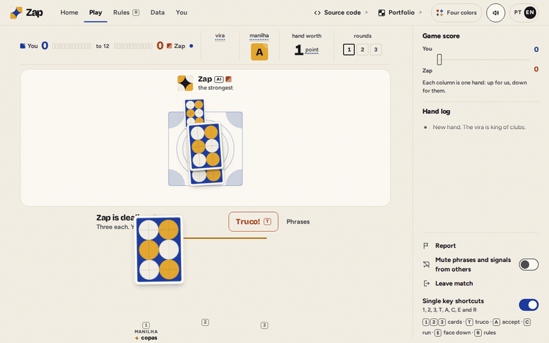
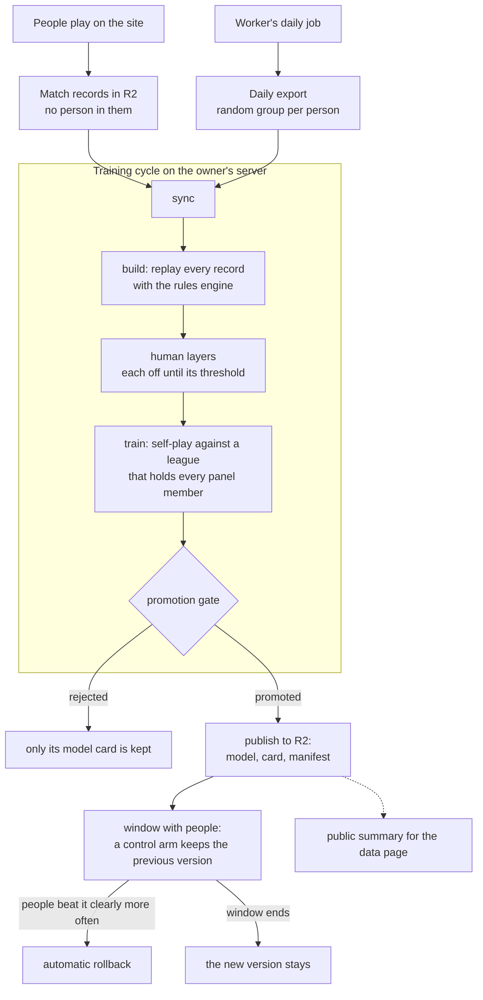
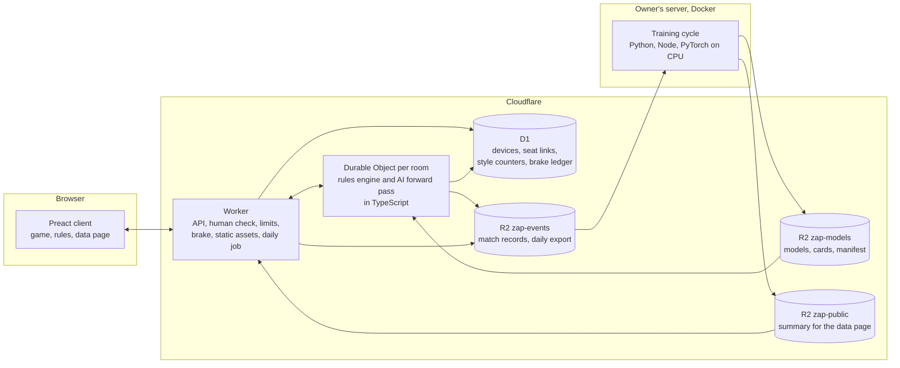

# Zap · truco against an AI that learns

Portuguese version: [README.pt-BR.md](README.pt-BR.md)



**Play:** [zap.andreiludescher.com/en](https://zap.andreiludescher.com/en/) · **How the AI learns, with every number:** [the data page](https://zap.andreiludescher.com/en/data)

Zap is a free truco game in the browser, in the paulista and mineiro variants, 1 against 1 or 2 against 2, where you play with and against an AI called Zap. The AI is a small neural network trained by self-play and served in TypeScript from a Cloudflare Worker: no language model plays, chooses or explains any move.

## Contents

* [Numbers at a glance](#numbers-at-a-glance)
* [How Zap learns](#how-zap-learns)
* [The promotion gate](#the-promotion-gate)
* [Human data, honestly](#human-data-honestly)
* [Reading the opponent during a match](#reading-the-opponent-during-a-match)
* [Architecture](#architecture)
* [Privacy](#privacy)
* [Limitations](#limitations)
* [Run it locally](#run-it-locally)
* [Repository map](#repository-map)
* [Documentation](#documentation)
* [Licenses](#licenses)

## Numbers at a glance

Every number in this README comes from code that ran, or from a setting or an outside source with the date it was read, and lives in [`facts.json`](facts.json); a test fails when the README drifts from it. This is a dated snapshot: the live numbers are on the [data page](https://zap.andreiludescher.com/en/data).

<!-- facts-template:snapshot
Snapshot of {snapshot.date:date}.

| Measure | Value | Measured |
| --- | --- | --- |
| The AI in play | {served.version}: {model.inputs:int} inputs, {model.layers:int} hidden layers of {model.hidden:int}, a {model.bytes:kb} KB file of int8 weights | {model.date:date} |
| {served.version} against random play | {strength.random:pct1} (from {strength.randomLo:pct1} to {strength.randomHi:pct1}) | {strength.date:date} |
| {served.version} against the rule-based player | {strength.base:pct1} (from {strength.baseLo:pct1} to {strength.baseHi:pct1}) | {strength.date:date} |
| {served.version} against the tuned rule-based player | {strength.tuned:pct1} (from {strength.tunedLo:pct1} to {strength.tunedHi:pct1}) | {strength.date:date} |
| {served.version} against {served.previous}, head to head | {strength.previous:pct1} (from {strength.previousLo:pct1} to {strength.previousHi:pct1}) | {strength.date:date} |
| Promotion gate of {served.version} against {served.previous} | {?gate.result=pass}passed every rule{/?}{?gate.result=fail}failed{/?} ([details](#the-promotion-gate)) | {gate.date:date} |
| The characters against a team of Zap (Zap against itself: {chars.zap:pct1}) | Otávio {chars.otavio:pct1}, Bento {chars.bento:pct1}, Lia {chars.lia:pct1}, Ravi {chars.ravi:pct1}, Iara {chars.iara:pct1} | {chars.date:date} |
| Decision time of {served.version} | {?decision.state=measured}{decision.p50:n2} ms per decision at the median, {decision.p99:n2} ms at p99; {decision.eventP99:n2} ms at p99 for everything the AI does before a person's next turn{/?}{?decision.state=unmeasured}not measured for this version yet{/?} | {?decision.state=measured}{decision.date:date}{/?} |
| Rules engine, one core, random legal moves | from {engine.min:int} to {engine.max:int} hands per second, by variant and table size | {engine.date:date} |
| Page load on a phone (slow 4G, throttled CPU, empty cache) | largest contentful paint (LCP) {client.lcp:int} ms at the median (budget {client.lcpBudget:int} ms); table drawn at {client.tableDrawn:int} ms | {client.date:date} |
| Code of the table, compressed | {client.js:kb} KB of JavaScript and {client.css:kb} KB of CSS (budgets {client.jsBudget:kb} KB and {client.cssBudget:kb} KB) | {client.date:date} |
| Tap on a card, throttled phone | answered within {client.tapMax:int} ms (budget {client.tapBudget:int} ms) | {client.date:date} |
| Card animations | {client.fpsDesktop:n1} frames per second on desktop, {client.fpsPhone:n1} on the throttled phone | {client.date:date} |
| Brake capacity on Workers Free, computed from the costs measured on the local site | {brake.soloPerDay:int} solo matches a day with the default reserve ({brake.soloPerDayLong:int} if matches last three times as long) | {brake.date:date} |
| Rows a room writes in its Durable Object | at most {brake.maxSoloRows:int} for a solo match (budget {brake.budgetSolo:int}), {brake.maxRoomRows:int} for a room of four people (budget {brake.budgetRoom:int}) | {brake.measuredDate:date} |

Strength is measured in duplicate pairs: every deal is played twice with the seats swapped, so the luck of the cards cancels out, and a pair scores 1, 0.5 or 0. Each rival played {strength.pairs:int} pairs over the four segments (paulista and mineiro, 1 against 1 and 2 against 2); the value is the mean match score with its 95% interval. On the same deals {served.previous} scored {strength.prevRandom:pct1}, {strength.prevBase:pct1} and {strength.prevTuned:pct1} against the first three rivals. The characters were measured on fresh deals of the gate, {chars.pairs:int} pairs per segment.{?strength.source=gate} For {served.version}, the rivals and their pairs are the frozen panel of the gate that promoted it.{/?}{?decision.source=judged} The decision time of {served.version} was measured on the file the explorer test judged: the same network under its earlier name.{/?} Speeds and times were measured on an idle virtual machine without AVX, with no training run sharing its CPU.
-->
<!-- facts:snapshot -->

Snapshot of 23 Nov 2026.

| Measure | Value | Measured |
| --- | --- | --- |
| The AI in play | v2: 461 inputs, 2 hidden layers of 256, a 194 KB file of int8 weights | 22 Nov 2026 |
| v2 against random play | 96.0% (from 95.5% to 96.4%) | 22 Nov 2026 |
| v2 against the rule-based player | 78.8% (from 78.0% to 79.6%) | 22 Nov 2026 |
| v2 against the tuned rule-based player | 87.5% (from 86.8% to 88.2%) | 22 Nov 2026 |
| v2 against v1, head to head | 69.6% (from 68.7% to 70.4%) | 22 Nov 2026 |
| Promotion gate of v2 against v1 | passed every rule ([details](#the-promotion-gate)) | 22 Nov 2026 |
| The characters against a team of Zap (Zap against itself: 50.0%) | Otávio 26.6%, Bento 32.0%, Lia 31.8%, Ravi 30.3%, Iara 41.0% | 22 Nov 2026 |
| Decision time of v2 | 0.22 ms per decision at the median, 0.33 ms at p99; 2.09 ms at p99 for everything the AI does before a person's next turn | 23 Nov 2026 |
| Rules engine, one core, random legal moves | from 92,894 to 115,410 hands per second, by variant and table size | 23 Nov 2026 |
| Page load on a phone (slow 4G, throttled CPU, empty cache) | largest contentful paint (LCP) 1,108 ms at the median (budget 2,500 ms); table drawn at 1,858 ms | 23 Nov 2026 |
| Code of the table, compressed | 89 KB of JavaScript and 20 KB of CSS (budgets 120 KB and 25 KB) | 23 Nov 2026 |
| Tap on a card, throttled phone | answered within 40 ms (budget 50 ms) | 23 Nov 2026 |
| Card animations | 60.0 frames per second on desktop, 60.0 on the throttled phone | 23 Nov 2026 |
| Brake capacity on Workers Free, computed from the costs measured on the local site | 1,111 solo matches a day with the default reserve (483 if matches last three times as long) | 23 Nov 2026 |
| Rows a room writes in its Durable Object | at most 37 for a solo match (budget 60), 145 for a room of four people (budget 320) | 22 Nov 2026 |

Strength is measured in duplicate pairs: every deal is played twice with the seats swapped, so the luck of the cards cancels out, and a pair scores 1, 0.5 or 0. Each rival played 4,000 pairs over the four segments (paulista and mineiro, 1 against 1 and 2 against 2); the value is the mean match score with its 95% interval. On the same deals v1 scored 93.0%, 74.5% and 79.6% against the first three rivals. The characters were measured on fresh deals of the gate, 400 pairs per segment. Speeds and times were measured on an idle virtual machine without AVX, with no training run sharing its CPU.

<!-- /facts:snapshot -->

## How Zap learns

The AI that plays today was trained by self-play alone. The training cycle that will also learn from people is built, tested end to end on local copies of the Cloudflare services, and waits for its first data. It runs in Docker on the owner's server, once a week or sooner when enough new matches arrive, and every step of it is code: the gate decides which version goes live, and no language model takes part in any step.



How the network learns, in short:

* **Inputs.** Each seat sees only what a person at that seat sees: its cards, the cards played, the score, the bets, the signals it caught. The tests check that no hidden card ever reaches the decision code.
* **Training.** Self-play workers in TypeScript play full matches with the real rules engine; a PyTorch learner on CPU first imitates a rule-based player, then improves by PPO with a pull towards a slowly moving anchor. The policy samples its actions, so its bluffs come in measured doses. A critic that sees every card during training lowers the noise and never leaves training.
* **Opponents.** The league mixes the current network, its recent snapshots, the earlier versions, the rule-based players, the five characters and players with extreme or switching styles, so the network cannot overfit to one rival.
* **Serving.** The same forward pass, written once in TypeScript (`ai/src/mlp.ts`), runs in the self-play workers, in the gate and inside the room on Cloudflare. A test checks that the learner's files give the same outputs there.
* **Characters.** Otávio, Bento, Lia, Ravi and Iara are the same network with knobs applied at decision time (temperature, bet offsets, bluffs), calibrated for each version so that Otávio is the easiest and Iara the hardest after Zap.

More in [`project_docs/ai.md`](project_docs/ai.md) and [`project_docs/cycle.md`](project_docs/cycle.md).

## The promotion gate

The owner asked for one guarantee in writing: bad data must not make the live AI worse without anyone noticing. Bad data can come from bots, from mistakes, or from people who play in odd ways on purpose. The cycle answers with guards on the data, a gate before any new version goes live, and a test with people after it does.

<!-- facts-template:gate
**Guards on the data.** Moves the room made for a person who timed out or left never count as that person's play, and records from local test sites never reach training (a production sync that finds one fails the cycle). Each browser has a trust weight and no browser weighs more than {cycle.deviceCap:pct0} of the training data. The cycle flags patterns of automated play (decision times too regular, play around the clock, unusual volume, identical sequences); a flagged browser weighs nothing from the next daily export on, and the owner reviews every flag.

**The gate.** Every game of the gate is a duplicate pair, and a candidate is promoted only when all four rules hold:

1. **Better than the version in play.** A sequential probability ratio test on the pooled pair scores looks after every round of {rule.batchPairs:int} new pairs. It tests a mean of {rule.p0:pct0} against one {rule.gain:pts1} points better, with error rates alpha {rule.alpha:pct0} and beta {rule.beta:pct0}, and stops as inconclusive, without promotion, at {rule.capPairs:int} pairs.
2. **Not worse in any segment.** Paulista and mineiro, 1 against 1 and 2 against 2, {rule.segmentPairs:int} new pairs each: the one-sided 95% lower bound of the candidate's edge must stay above minus {rule.segmentMargin:pts1} points.
3. **Not worse against a frozen panel.** The random player, the rule-based and tuned rule-based players, v1 and the last {rule.panelVersions:int} promoted versions each play the candidate and the current version on the same deals, {rule.panelPairs:int} pairs per segment. For every member, the one-sided 95% lower bound of the candidate's difference must stay above minus {rule.panelMargin:pts0} point. The panel does not move with the data, so a candidate that learned something odd from people still has to hold up against opponents that never change.
4. **The characters keep their order.** The characters are calibrated on the candidate and measured again on fresh deals; the gate fails when Otávio is no longer the easiest or Iara no longer the hardest after Zap, beyond noise.

Each rule alone lets through a candidate worse than its margin at most {rule.alpha:pct0} of the time, and since all four must pass, that bound holds for the gate as a whole.

**The window with people.** After a promotion, for {ab.days:int} days, {ab.share:pct0} of solo matches keep the previous version in every AI seat (the control arm). In the other matches the new version sits only in opponent seats, never as a person's partner. Once a day the cycle compares how often people beat each arm, with each person as one cluster in a bootstrap. When both arms have at least {ab.minMatches:int} matches and a cautious lower bound of the drop is above {ab.rollbackDrop:pts0} points, the cycle rolls the new version back on its own and the model card says why. The owner can also roll back at any time with one command, and no new version is promoted while a window is open.

**What {served.version} went through.** {served.version} met this gate against {served.previous} on {gate.date:date}, {?gate.where=local}on a local copy of the cycle with the production sizes{/?}{?gate.where=server}on the training server{/?}{?gate.stats=live}, with the reading live{/?}, and {?gate.result=pass}passed every rule{/?}{?gate.result=fail}failed{/?}. The sequential test accepted after {gate.sprtPairs:int} pairs (mean {gate.sprtMean:pct1}). Per segment, on {gate.segPairs:int} pairs each: {gate.paulista1:pct1} in paulista 1 against 1, {gate.paulista2:pct1} in paulista 2 against 2, {gate.mineiro1:pct1} in mineiro 1 against 1 and {gate.mineiro2:pct1} in mineiro 2 against 2. Against the panel, {gate.panelPairs:int} pairs per member, the lowest one-sided bound of a difference was {?gate.panelSide=above}{gate.panelLowest:pts1} points above zero{/?}{?gate.panelSide=below}{gate.panelLowestAbs:pts2} points below zero, within the margin of {rule.panelMargin:pts0} point{/?}.{?window.any=no} No window with people has run yet.{/?}{?window.state=open} Its window with people runs until {window.until:date}.{/?}{?window.state=closed} Its window with people ended on {window.until:date}, and it stayed.{/?}
-->
<!-- facts:gate -->

**Guards on the data.** Moves the room made for a person who timed out or left never count as that person's play, and records from local test sites never reach training (a production sync that finds one fails the cycle). Each browser has a trust weight and no browser weighs more than 2% of the training data. The cycle flags patterns of automated play (decision times too regular, play around the clock, unusual volume, identical sequences); a flagged browser weighs nothing from the next daily export on, and the owner reviews every flag.

**The gate.** Every game of the gate is a duplicate pair, and a candidate is promoted only when all four rules hold:

1. **Better than the version in play.** A sequential probability ratio test on the pooled pair scores looks after every round of 400 new pairs. It tests a mean of 50% against one 1.5 points better, with error rates alpha 5% and beta 5%, and stops as inconclusive, without promotion, at 40,000 pairs.
2. **Not worse in any segment.** Paulista and mineiro, 1 against 1 and 2 against 2, 2,500 new pairs each: the one-sided 95% lower bound of the candidate's edge must stay above minus 1.5 points.
3. **Not worse against a frozen panel.** The random player, the rule-based and tuned rule-based players, v1 and the last 3 promoted versions each play the candidate and the current version on the same deals, 2,500 pairs per segment. For every member, the one-sided 95% lower bound of the candidate's difference must stay above minus 1 point. The panel does not move with the data, so a candidate that learned something odd from people still has to hold up against opponents that never change.
4. **The characters keep their order.** The characters are calibrated on the candidate and measured again on fresh deals; the gate fails when Otávio is no longer the easiest or Iara no longer the hardest after Zap, beyond noise.

Each rule alone lets through a candidate worse than its margin at most 5% of the time, and since all four must pass, that bound holds for the gate as a whole.

**The window with people.** After a promotion, for 14 days, 30% of solo matches keep the previous version in every AI seat (the control arm). In the other matches the new version sits only in opponent seats, never as a person's partner. Once a day the cycle compares how often people beat each arm, with each person as one cluster in a bootstrap. When both arms have at least 200 matches and a cautious lower bound of the drop is above 2 points, the cycle rolls the new version back on its own and the model card says why. The owner can also roll back at any time with one command, and no new version is promoted while a window is open.

**What v2 went through.** v2 met this gate against v1 on 22 Nov 2026, on a local copy of the cycle with the production sizes, and passed every rule. The sequential test accepted after 400 pairs (mean 70.3%). Per segment, on 2,500 pairs each: 80.5% in paulista 1 against 1, 67.5% in paulista 2 against 2, 72.5% in mineiro 1 against 1 and 60.8% in mineiro 2 against 2. Against the panel, 10,000 pairs per member, the lowest one-sided bound of a difference was 1.9 points above zero. No window with people has run yet.

<!-- /facts:gate -->

The rules and their error rates are explained in [`project_docs/cycle.md`](project_docs/cycle.md); the settings live in [`training/cycle/config/prod.toml`](training/cycle/config/prod.toml).

## Human data, honestly

<!-- facts-template:human
{?human.state=none}No match with people has been counted yet, and {served.version} was trained by self-play alone.{/?}{?human.state=window}People have played against a version of Zap in a test window, but no match with people has trained Zap yet: {served.version} was trained by self-play alone.{/?} So "an AI trained by the people who play" describes the design; it is not a measured result yet. The layers that learn from people are written and tested, and each one switches itself on when the weekly cycle finds enough data. Until then the cycle trains without them.

* **Human behaviour model**, a network that plays like people and joins training as an opponent and as a partner: after {th.humanModelMatches:int} valid matches from at least {th.humanModelDevices:int} devices, and only when it predicts people's decisions better than a simple baseline.
* **Twin without human data**: whenever the human model is in training, the cycle also trains a twin with the same start, seed and compute but without it. The difference between the two, read against how far two twins land apart by seed alone, is how "people's data made it stronger" will be measured. The data page will show where human data adds strength and where it does not.
* **Per-player profile**: the "How Zap reads you" panel on the You page compares a person's own counts with population values, which come from people once {th.priorsPeople:int} people have enough observations of a number, and from the AI's own play until then. Using the profile to adapt the AI to a person across matches needs {th.adaptDecisions:int} decisions of that person and is not built yet.
* **Player types**: from {th.playerTypes:int} people with a full reading.
* **Seventh character**, the human model at the table: after the human model passes its test and the Worker serves it.
* **Open data** under CC BY 4.0, in this repository's GitHub releases: from {th.openDataMatches:int} valid human matches, with every cell covering at least {th.minCellPeople:int} people.
* **Public ranking**, opt in: when {th.rankingPeople:int} people have played {th.rankingMatches:int} matches each.
-->
<!-- facts:human -->

No match with people has been counted yet, and v2 was trained by self-play alone. So "an AI trained by the people who play" describes the design; it is not a measured result yet. The layers that learn from people are written and tested, and each one switches itself on when the weekly cycle finds enough data. Until then the cycle trains without them.

* **Human behaviour model**, a network that plays like people and joins training as an opponent and as a partner: after 500 valid matches from at least 50 devices, and only when it predicts people's decisions better than a simple baseline.
* **Twin without human data**: whenever the human model is in training, the cycle also trains a twin with the same start, seed and compute but without it. The difference between the two, read against how far two twins land apart by seed alone, is how "people's data made it stronger" will be measured. The data page will show where human data adds strength and where it does not.
* **Per-player profile**: the "How Zap reads you" panel on the You page compares a person's own counts with population values, which come from people once 100 people have enough observations of a number, and from the AI's own play until then. Using the profile to adapt the AI to a person across matches needs 150 decisions of that person and is not built yet.
* **Player types**: from 200 people with a full reading.
* **Seventh character**, the human model at the table: after the human model passes its test and the Worker serves it.
* **Open data** under CC BY 4.0, in this repository's GitHub releases: from 1,000 valid human matches, with every cell covering at least 20 people.
* **Public ranking**, opt in: when 50 people have played 20 matches each.

<!-- /facts:human -->

## Reading the opponent during a match

**What it is.** An adaptive version of the network counts public facts about each other player in the finished hands of the current match: how often they ask for truco or raise, run, accept or raise back, how strong the cards they show after raising are, and how often they play face down, with how many observations stand behind each share. Each share starts at a population value and moves only as evidence builds up. A safety net caps how far the play may move away from the play without reading, by an amount that grows with the evidence. No rule tells the network what to do with what it reads: it learned that in self-play against opponents of very different styles. Nothing is kept from one match to the next, and anyone can switch it off for their table with "Don't adapt to me" on the You page.

<!-- facts-template:reading
{?reading.state=off-fails}
**Status: off.** The version in play, {served.version} (features `{model.features}`), reads nothing about anyone, and `AI_ADAPT` is `{reading.aiAdapt}`. The reason is the explorer test. An explorer is an opponent built to fake a pattern and then switch, so that the reading misjudges it; the test searches for explorers among scripted players and also trains one by reinforcement learning against the adaptive network. The rule: against the file that would be served, no explorer may gain more than {reading.limit:pts0} point from the reading, judged by the one-sided 95% upper bound of its score against the network with reading on minus its score against the same file with reading off, on the same deals. For the candidate file (SHA-256 `{reading.candidate}`, safety net Bmax {reading.bmax:n1}, nHalf {reading.nHalf:int}), {reading.explorersPass:int} of {reading.explorers:int} explorers pass. The explorer `{reading.worst}` gains {reading.worstMean:pts2} points from the reading (from {reading.worstLo:pts2} to {reading.worstHi:pts2}), with an upper bound of {reading.worstUpper:pts2}, above the limit. So the reading stays off. Verdict of {reading.date:date}.
{/?}

{?reading.state=off-passes}
**Status: ready, not live.** The version in play, {served.version} (features `{model.features}`), reads nothing about anyone, and `AI_ADAPT` is `{reading.aiAdapt}`. The explorer test passes for the candidate file (SHA-256 `{reading.candidate}`, safety net Bmax {reading.bmax:n1}, nHalf {reading.nHalf:int}): all {reading.explorers:int} explorers measured against it stay within the limit of {reading.limit:pts0} point; the largest upper bound is {reading.worstUpper:pts2} points, for `{reading.worst}`. An explorer is an opponent built to fake a pattern and then switch, so that the reading misjudges it. The reading goes live only if the owner adopts that file through the training cycle: it becomes the next version, must pass the full gate with the reading live, and then plays people for {ab.days:int} days, with {ab.share:pct0} of quick play matches kept on the previous version for comparison. That test with people decides whether it stays. Verdict of {reading.date:date}.
{/?}

{?reading.state=window}
**Status: in a test with people.** The version in play, {served.version} (features `{model.features}`), reads the public facts of the current match, and `AI_ADAPT` is `{reading.aiAdapt}`. It was adopted through the training cycle on {reading.from:date}, passed the full gate with the reading live, and plays people until {reading.until:date}: {reading.share:pct0} of quick play matches keep {reading.control} on every AI seat for comparison, and in the others {served.version} sits only in opponent seats, never as a person's partner. Once a day the cycle compares how often people beat each version, and it rolls {served.version} back on its own when they clearly beat it more often. The data page shows that comparison once each group has {th.minCellPeople:int} people. This test decides whether the reading stays.
{/?}

{?reading.state=on}
**Status: on.** The version in play, {served.version} (features `{model.features}`), reads the public facts of the current match, and `AI_ADAPT` is `{reading.aiAdapt}`. It was adopted through the training cycle on {reading.from:date} and stayed after its test window with people.
{/?}

{?reading.state=on-bundled}
**Status: on.** The version in play, {served.version} (features `{model.features}`), reads the public facts of the current match, and `AI_ADAPT` is `{reading.aiAdapt}`.
{/?}

{?reading.state=noevidence}
**Status: off.** The version in play, {served.version}, carries the reading (features `{model.features}`), but `AI_ADAPT` is `{reading.aiAdapt}`, so it plays every table as if it had seen nothing from anyone.{/?}{?reading.offWindow=yes} Its window with people still runs until {reading.until:date}: {reading.share:pct0} of quick play matches keep {reading.control} on every AI seat, and in the others {served.version} sits only in opponent seats.{/?}

{?reading.state=rolled-back}
**Status: off again.** The version in play, {served.version} (features `{model.features}`), reads nothing about anyone. {reading.version} carried the reading: it was adopted through the training cycle on {reading.from:date} and rolled back to {reading.rolledTo} on {reading.rolledAt:date}.
{/?}

{?reading.tested=yes}
The explorer test passed for the network of {reading.version}: it has the same weights as the file with SHA-256 `{reading.candidate}` (safety net Bmax {reading.bmax:n1}, nHalf {reading.nHalf:int}), and all {reading.explorers:int} explorers measured against that file stay within the limit of {reading.limit:pts0} point; the largest upper bound is {reading.worstUpper:pts2} points, for `{reading.worst}`. An explorer is an opponent built to fake a pattern and then switch, so that the reading misjudges it. Verdict of {reading.date:date}.
{/?}

{?reading.tested=card}
The explorer test of the training cycle passed for the network of {reading.version} before its promotion: all {reading.cardExplorers:int} explorers measured against it stay within the limit of {reading.cardLimit:pts0} point; the largest upper bound is {reading.cardWorstUpper:pts2} points, for `{reading.cardWorst}`. An explorer is an opponent built to fake a pattern and then switch, so that the reading misjudges it.
{/?}

{?reading.tested=no}
No explorer test measured the network of {reading.version}: the verdict of {reading.date:date} is about another file (SHA-256 `{reading.candidate}`) and says nothing about this one. An explorer is an opponent built to fake a pattern and then switch, so that the reading misjudges it.
{/?}

{?reading.tested=none}
No verdict of the explorer test is recorded for the network of {reading.version}.
{/?}

{?reading.result=public}
In its window with people, from {reading.from:date} to {reading.windowEnd:date}, {reading.control} won {reading.drop:pts1} points more of its matches against people than {reading.version} did (90% interval from {reading.dropLo:pts1} to {reading.dropHi:pts1}); a negative value means {reading.version} won more.
{/?}

{?reading.result=few}
Its window with people, from {reading.from:date} to {reading.windowEnd:date}, ended without a public comparison: each group needs at least {th.minCellPeople:int} people.
{/?}

{?reading.state=off-unmeasured}
**Status: off.** The version in play, {served.version} (features `{model.features}`), reads nothing about anyone, and no verdict of the explorer test is recorded.
{/?}

{?reading.gainSameFile=yes}
For scale, on the same candidate file the reading adds {reading.gain:pts2} points to Zap's score against the opponent styles of the test (from {reading.gainLo:pts2} to {reading.gainHi:pts2}).
{/?}

{?reading.gainSameFile=told}
For scale, on the network of {reading.version} the reading adds {reading.gain:pts2} points to Zap's score against the opponent styles of the test (from {reading.gainLo:pts2} to {reading.gainHi:pts2}).
{/?}

{?reading.caveats!=no}
Two measurements of the same file weigh against it. Head to head against its twin, the same training without the statistics, it scores {reading.vsTwin:pct1} (from {reading.vsTwinLo:pct1} to {reading.vsTwinHi:pct1}), so it is not stronger overall. By one more measure its base is easier to exploit: an explorer trained against it by reinforcement learning takes {reading.exploit:pts2} points more from it (from {reading.exploitLo:pts2} to {reading.exploitHi:pts2}) than a control explorer, trained the same way against {reading.controlVersion}, takes from the twin. The control was measured against the twin, not against the {reading.controlVersion} it trained against, so this comparison is less clean than the one above.{/?}{?reading.caveats=yes-costs} The reading is not what that explorer exploits: it costs the explorer {reading.trainedCost:pts2} points.{/?}


{?reading.offPolicy=yes}
After an adoption, a table with "Don't adapt to me" plays the same file without reading, which scores {reading.offH2h:pct1} (from {reading.offH2hLo:pct1} to {reading.offH2hHi:pct1}) head to head against its twin: it is weaker, so that works in that person's favour. With `AI_ADAPT` off every table would play that weaker network, so the reading is then switched off with the cycle's rollback to the previous version, not with `AI_ADAPT` off.
{/?}

{?reading.offPolicy=live}
A table with "Don't adapt to me" plays {served.version} without reading. That network scores {reading.offH2h:pct1} (from {reading.offH2hLo:pct1} to {reading.offH2hHi:pct1}) head to head against its twin: it is weaker, so that works in that person's favour. With `AI_ADAPT` off every table would play it, so the reading is switched off with the cycle's rollback to the previous version, not with `AI_ADAPT` off.
{/?}

{?reading.offPolicy=all}
That network without reading scores {reading.offH2h:pct1} (from {reading.offH2hLo:pct1} to {reading.offH2hHi:pct1}) head to head against its twin, so every table now plays a network weaker than the twin. The way to switch the reading off is the cycle's rollback to the previous version.
{/?}

{?reading.offPolicy=all-window}
That network without reading scores {reading.offH2h:pct1} (from {reading.offH2hLo:pct1} to {reading.offH2hHi:pct1}) head to head against its twin, so the matches of the test group now face a network weaker than the twin, while the control group plays {reading.control}. The way to switch the reading off is the cycle's rollback to the previous version.
{/?}
-->
<!-- facts:reading -->

**Status: ready, not live.** The version in play, v2 (features `v2-empty`), reads nothing about anyone, and `AI_ADAPT` is `off`. The explorer test passes for the candidate file (SHA-256 `7223c227`, safety net Bmax 0.2, nHalf 1): all 9 explorers measured against it stay within the limit of 1 point; the largest upper bound is 0.77 points, for `neverRaises>bluffer@3/same`. An explorer is an opponent built to fake a pattern and then switch, so that the reading misjudges it. The reading goes live only if the owner adopts that file through the training cycle: it becomes the next version, must pass the full gate with the reading live, and then plays people for 14 days, with 30% of quick play matches kept on the previous version for comparison. That test with people decides whether it stays. Verdict of 23 Nov 2026.

For scale, on the same candidate file the reading adds 0.24 points to Zap's score against the opponent styles of the test (from 0.13 to 0.35).

Two measurements of the same file weigh against it. Head to head against its twin, the same training without the statistics, it scores 49.1% (from 48.3% to 49.9%), so it is not stronger overall. By one more measure its base is easier to exploit: an explorer trained against it by reinforcement learning takes 3.44 points more from it (from 2.60 to 4.29) than a control explorer, trained the same way against v2, takes from the twin. The control was measured against the twin, not against the v2 it trained against, so this comparison is less clean than the one above. The reading is not what that explorer exploits: it costs the explorer 1.00 points.

After an adoption, a table with "Don't adapt to me" plays the same file without reading, which scores 48.5% (from 47.7% to 49.4%) head to head against its twin: it is weaker, so that works in that person's favour. With `AI_ADAPT` off every table would play that weaker network, so the reading is then switched off with the cycle's rollback to the previous version, not with `AI_ADAPT` off.

<!-- /facts:reading -->

The [data page](https://zap.andreiludescher.com/en/data#leitura) explains the reading step by step, with every explorer and its interval, the comparison with the twin and the control explorer, and states this status from the same numbers.

## Architecture



| Part | Runs on | What it does |
| --- | --- | --- |
| Client (`web/`) | the browser | Preact pages prerendered in both languages, talking to the Worker over HTTPS and to the room over a WebSocket: the table, the rules with interactive examples, the data page and the You page |
| Worker (`worker/src/cf/index.ts`) | Cloudflare Workers | the site's static assets, the API, the human check (Turnstile), rate limits, the brake, the daily job (retention, export, imports from the cycle) |
| Room (`worker/src/cf/room.ts`) | a Durable Object per room | the match itself: rules engine, AI seats, timers by alarm, reconnection, WebSocket hibernation |
| Rules engine (`engine/`) | everywhere | both variants, deterministic from a seed, shared by the room, the client's guided match, training and the gate |
| AI (`ai/`) | the room, training, the gate | the forward pass, the characters, the reading statistics and the safety net |
| Training cycle (`training/cycle/`) | the owner's server | sync, build, human layers, training, gate, publish, the window with people, rollback |
| Storage | D1 and R2 | D1 for devices, seat links and counters; R2 for match records, models and the public summary |

## Privacy

<!-- facts-template:privacy
* **No accounts.** A random secret in an HttpOnly cookie identifies the browser and the server keeps only its hash. People get a random pseudonym and may choose a nickname, which passes a filter. No email, no password, and no IP address is stored; rate limits use a keyed hash of the IP that changes every day.
* **Adults only, by self-declaration.** A neutral screen asks for the birth year from a list. Only "adult: yes" and its time are stored, and the year never leaves the browser. People who say they are under age can read the rules and the data page but cannot play, and nothing about them reaches the server.
* **Match records hold no person.** A record in R2 carries the match id and seat numbers only. The link between a person and their seats lives in D1 and goes away when the person deletes their data, or after a year without playing. The "You against Zap" page keeps a copy of the person's own records in that browser, until they delete their data there or press "Forget the games stored on this device".
* **Delete and download at once,** on the You page, with a recovery code to move a history to another browser. "Don't adapt to me" deletes the style counters and keeps no new ones.
* **Nothing hidden leaves the server during a match.** The room sends each seat only what that seat may see: no message carries another player's hidden card, cards played face down are never revealed during the match, and the seed of each hand is shown only after the match ends. The AI receives the same view a person has at its seat.
* **Public numbers and open data have floors.** Apart from site-wide totals (matches played, moves made, matches people won against Zap), a number built from people's data is published only for a group of at least {th.minCellPeople:int} distinct people. Open data releases give each match a new random code, dates as ISO weeks and decision times in bands, show style figures only as aggregates, and leave out anyone who chose "Keep me out of open data" or deleted their data. A published release cannot be withdrawn, and the notice says so.
* **Where data lives.** Rooms run in eastern North America and Cloudflare may store D1 and R2 data outside Brazil; open data releases are hosted on GitHub.
* **No ads.** The ad structure exists and is switched off: no ad script, no ads.txt, no requests to ad domains.
-->
<!-- facts:privacy -->

* **No accounts.** A random secret in an HttpOnly cookie identifies the browser and the server keeps only its hash. People get a random pseudonym and may choose a nickname, which passes a filter. No email, no password, and no IP address is stored; rate limits use a keyed hash of the IP that changes every day.
* **Adults only, by self-declaration.** A neutral screen asks for the birth year from a list. Only "adult: yes" and its time are stored, and the year never leaves the browser. People who say they are under age can read the rules and the data page but cannot play, and nothing about them reaches the server.
* **Match records hold no person.** A record in R2 carries the match id and seat numbers only. The link between a person and their seats lives in D1 and goes away when the person deletes their data, or after a year without playing. The "You against Zap" page keeps a copy of the person's own records in that browser, until they delete their data there or press "Forget the games stored on this device".
* **Delete and download at once,** on the You page, with a recovery code to move a history to another browser. "Don't adapt to me" deletes the style counters and keeps no new ones.
* **Nothing hidden leaves the server during a match.** The room sends each seat only what that seat may see: no message carries another player's hidden card, cards played face down are never revealed during the match, and the seed of each hand is shown only after the match ends. The AI receives the same view a person has at its seat.
* **Public numbers and open data have floors.** Apart from site-wide totals (matches played, moves made, matches people won against Zap), a number built from people's data is published only for a group of at least 20 distinct people. Open data releases give each match a new random code, dates as ISO weeks and decision times in bands, show style figures only as aggregates, and leave out anyone who chose "Keep me out of open data" or deleted their data. A published release cannot be withdrawn, and the notice says so.
* **Where data lives.** Rooms run in eastern North America and Cloudflare may store D1 and R2 data outside Brazil; open data releases are hosted on GitHub.
* **No ads.** The ad structure exists and is switched off: no ad script, no ads.txt, no requests to ad domains.

<!-- /facts:privacy -->

Not legal advice: this is how a personal project reasons about its data, and no lawyer has reviewed it. The full reasoning is in [`project_docs/privacy-lia.md`](project_docs/privacy-lia.md), what is kept and for how long in [`project_docs/retention.md`](project_docs/retention.md), and every field in [`project_docs/data-dictionary.md`](project_docs/data-dictionary.md).

## Limitations

<!-- facts-template:limits
* **Rooms live in eastern North America.** Cloudflare has no Durable Object region in South America, so a room opened from Brazil runs in the United States and every move crosses that distance.
* {?reading.live=no}**The reading is off** (see [above](#reading-the-opponent-during-a-match)), so the Zap of today plays the same against everyone.{/?}{?reading.live=window}**The reading is still in its test with people** (see [above](#reading-the-opponent-during-a-match)): it may yet be rolled back, and {reading.share:pct0} of quick play matches keep {reading.control} until {reading.until:date}.{/?}{?reading.live=on}**The reading forgets between matches.** It counts only the current match (see [above](#reading-the-opponent-during-a-match)), so Zap meets every person as a stranger when a match starts.{/?}
* **The characters' styles overlap.** In a test that tells two characters apart from windows of their play{?chars.sepOther=yes}, measured on {chars.sepVersion}{/?}, {chars.sepAtTarget:int} of {chars.sepPairs:int} pairs reach the target accuracy of {chars.sepTarget:pct0} with their whole interval and {chars.sepBelow:int} stay below it; Iara is told apart from Zap {chars.iaraZap:pct1} of the time, little better than a coin toss. Otávio is clearly the easiest and Iara the hardest after Zap, while Bento, Lia and Ravi are about equally hard.
* **Workers Free and the brake.** The site runs on Cloudflare's free plan, whose daily limits belong to the whole account and are shared with the owner's other projects. Before a match starts, the Worker reserves its typical cost; a match that would take any limit past {brake.headroom:pct0} of it, minus a reserve for the other projects ({brake.reserve:pct0} of each limit by default), does not start, and the person reads when to come back. With these settings the brake admits {brake.soloPerDay:int} solo matches a day, or {brake.soloPerDayLong:int} if real matches last three times as long as the simulated ones. Those costs were measured on the local site; in production the real spend replaces the estimate as matches end.
* {?prod.state=none}**No production numbers yet.** Every number here comes from local runs. The gate of {served.version} ran on a local copy of the training cycle, the window with people has never run, and nobody outside the project has played.{/?}{?prod.state=local-window}**No production numbers yet.** Every number here comes from local runs: the gate of {served.version} and the test window ran on a local copy of the training cycle, the window with scripted players in place of people, and nobody outside the project has played.{/?}{?prod.state=server}**Numbers from programs.** The strength, gate and character numbers here come from games between programs; how people fare against Zap is on the data page, where a number built from people's games needs a group of at least {th.minCellPeople:int} people.{/?}
* **Two variants, one set of house rules.** Paulista and mineiro with the defaults and room options of [`project_docs/rules.md`](project_docs/rules.md); many tables play other house rules.
-->
<!-- facts:limits -->

* **Rooms live in eastern North America.** Cloudflare has no Durable Object region in South America, so a room opened from Brazil runs in the United States and every move crosses that distance.
* **The reading is off** (see [above](#reading-the-opponent-during-a-match)), so the Zap of today plays the same against everyone.
* **The characters' styles overlap.** In a test that tells two characters apart from windows of their play, 3 of 15 pairs reach the target accuracy of 80% with their whole interval and 10 stay below it; Iara is told apart from Zap 54.3% of the time, little better than a coin toss. Otávio is clearly the easiest and Iara the hardest after Zap, while Bento, Lia and Ravi are about equally hard.
* **Workers Free and the brake.** The site runs on Cloudflare's free plan, whose daily limits belong to the whole account and are shared with the owner's other projects. Before a match starts, the Worker reserves its typical cost; a match that would take any limit past 80% of it, minus a reserve for the other projects (50% of each limit by default), does not start, and the person reads when to come back. With these settings the brake admits 1,111 solo matches a day, or 483 if real matches last three times as long as the simulated ones. Those costs were measured on the local site; in production the real spend replaces the estimate as matches end.
* **No production numbers yet.** Every number here comes from local runs. The gate of v2 ran on a local copy of the training cycle, the window with people has never run, and nobody outside the project has played.
* **Two variants, one set of house rules.** Paulista and mineiro with the defaults and room options of [`project_docs/rules.md`](project_docs/rules.md); many tables play other house rules.

<!-- /facts:limits -->

## Run it locally

Everything runs in Docker with the project's Compose services; nothing is installed on the host, and caches stay in `.cache/` inside the project. The local site uses wrangler dev with local D1, R2 and Durable Objects and Cloudflare's Turnstile test keys, so it never touches a Cloudflare account.

Needs Docker with the Compose plugin (the version [`DEPLOY.md`](DEPLOY.md#before-you-start) asks for in "Before you start"). The Node containers run as the image's `node` user, so files they write belong to that user id.

```sh
# Dependencies, local settings and the client build
docker compose run --rm -T node npm ci
cp .dev.vars.example .dev.vars
docker compose run --rm -T node npm run build:web

# The local site on http://127.0.0.1:8787
docker compose up -d dev
```

Tests:

```sh
docker compose run --rm -T node npm run typecheck
docker compose run --rm -T node npx vitest run

# Integration tests against the running local site
docker compose run --rm -T -e BASE=http://dev:8787 node npx vitest run tests/integration

# End to end tests in Chromium, against a second local site whose clocks run faster
docker compose --profile e2e up -d dev-e2e
docker run --rm --network host --user "$(id -u):$(id -g)" -v "$PWD":/app -w /app -e HOME=/app/.cache/home \
  mcr.microsoft.com/playwright:v1.65.1-noble npx playwright test --config tests/e2e/playwright.config.ts

# The README numbers against facts.json
docker compose run --rm -T node node tools/docs/readme-facts.ts --check
```

A short training run on CPU, after fetching the Python wheels and building the training image (the "Images" step of the training server in [`DEPLOY.md`](DEPLOY.md#73-images)):

```sh
docker compose --profile train run --rm -T train python training/train.py --run .cache/short-run \
  --iters 2 --imitation-iters 1 --decisions 5000 --workers 1 --threads 1 --eval-every 1 --eval-pairs 20
```

It writes its metrics (`metrics.jsonl`), the checkpoint, the current model file and the league snapshots under `.cache/short-run/`. The training cycle's own commands and its local end to end runs are in [`training/cycle/README.md`](training/cycle/README.md).

## Repository map

| Path | What |
| --- | --- |
| `engine/` | the rules engine of both variants, with property tests and simulated matches |
| `ai/` | the forward pass, players, characters, reading statistics and safety net; `ai/bench/` measures them; `ai/models/bootstrap/` holds the bundled models and their cards |
| `training/` | self-play workers, the PyTorch learner and `training/cycle/`, the weekly cycle |
| `worker/` | the Worker, the room, D1 migrations, privacy, the brake |
| `web/` | the client and the data page; `web/src/data/generated/` holds the files the data page reads |
| `shared/` | formats and code shared by the Worker, the client and the cycle |
| `locales/` | the site's texts in Portuguese and English |
| `tests/` | integration, end to end, performance, screenshots and simulations |
| `tools/` | generators for the data page, the shouts, the social images and the README numbers |
| `project_docs/` | how each part works, in English |
| `docker/`, `docker-compose.yml` | the images and services everything runs in |
| `facts.json` | every measured number, with its date and method |

## Documentation

* [`DEPLOY.md`](DEPLOY.md): the first deploy on Cloudflare, the checks after it, the brake and when to move to Workers Paid, ads in test mode, and the training server.
* [`project_docs/ai.md`](project_docs/ai.md): how the AI works, how it was trained and what ships.
* [`project_docs/cycle.md`](project_docs/cycle.md): the training cycle, the gate, the window with people and the human layers.
* [`project_docs/data-page.md`](project_docs/data-page.md): how each number of the data page is made.
* [`project_docs/brake.md`](project_docs/brake.md): the admission control for Cloudflare's daily limits.
* [`project_docs/rules.md`](project_docs/rules.md): the rules, their sources and the room options.
* [`project_docs/privacy-lia.md`](project_docs/privacy-lia.md), [`project_docs/retention.md`](project_docs/retention.md), [`project_docs/data-dictionary.md`](project_docs/data-dictionary.md), [`project_docs/moderation.md`](project_docs/moderation.md): privacy, retention, the data map and moderation.
* [`training/cycle/README.md`](training/cycle/README.md) and [`training/cycle/SERVER.md`](training/cycle/SERVER.md): the cycle's commands and its daily life on the server.

## Licenses

* Code and model weights: MIT, in [`LICENSE`](LICENSE).
* Card art, the shouts, texts, the data page and the open data releases: CC BY 4.0, in [`LICENSE-CONTENT`](LICENSE-CONTENT).
* Fonts, the tools that made the shouts, libraries and rule sources: [`CREDITS.md`](CREDITS.md).
