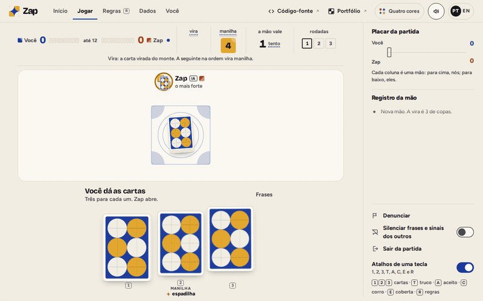
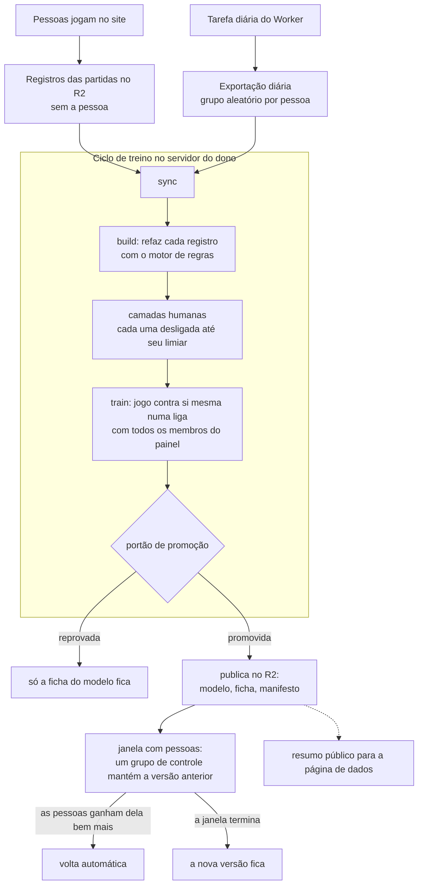
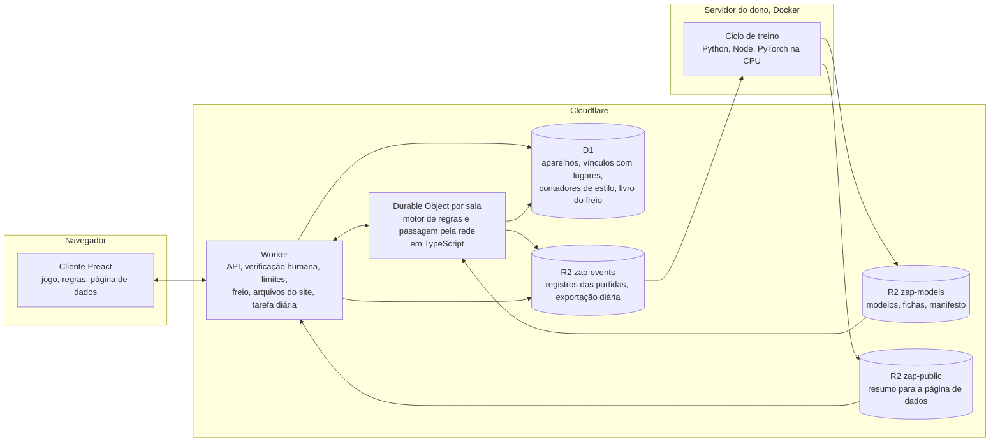

# Zap · truco contra uma IA que aprende

Versão em inglês: [README.md](README.md)



**Jogar:** [zap.andreiludescher.com](https://zap.andreiludescher.com/) · **Como a IA aprende, com todos os números:** [a página de dados](https://zap.andreiludescher.com/dados)

O Zap é um jogo de truco gratuito no navegador, nas variantes paulista e mineiro, 1 contra 1 ou 2 contra 2, em que você joga com e contra uma IA chamada Zap. A IA é uma rede neural pequena, treinada jogando contra si mesma e servida em TypeScript a partir de um Worker da Cloudflare: nenhum modelo de linguagem joga, escolhe ou explica qualquer jogada.

## Conteúdo

* [Os números em resumo](#os-números-em-resumo)
* [Como o Zap aprende](#como-o-zap-aprende)
* [O portão de promoção](#o-portão-de-promoção)
* [Dados humanos, com franqueza](#dados-humanos-com-franqueza)
* [A leitura do adversário durante a partida](#a-leitura-do-adversário-durante-a-partida)
* [Arquitetura](#arquitetura)
* [Privacidade](#privacidade)
* [Limitações](#limitações)
* [Como rodar localmente](#como-rodar-localmente)
* [Mapa do repositório](#mapa-do-repositório)
* [Documentação](#documentação)
* [Licenças](#licenças)

## Os números em resumo

Todo número deste README sai de código que rodou, ou de uma configuração ou fonte externa com a data da leitura, e fica no [`facts.json`](facts.json); um teste falha quando o README se afasta dele. É um retrato com data: os números ao vivo ficam na [página de dados](https://zap.andreiludescher.com/dados).

<!-- facts-template:snapshot
Retrato de {snapshot.date:date}.

| Medida | Valor | Medido em |
| --- | --- | --- |
| A IA em jogo | {served.version}: {model.inputs:int} entradas, {model.layers:int} camadas ocultas de {model.hidden:int}, um arquivo de {model.bytes:kb} KB com pesos int8 | {model.date:date} |
| {served.version} contra jogadas ao acaso | {strength.random:pct1} (de {strength.randomLo:pct1} a {strength.randomHi:pct1}) | {strength.date:date} |
| {served.version} contra o jogador de regras | {strength.base:pct1} (de {strength.baseLo:pct1} a {strength.baseHi:pct1}) | {strength.date:date} |
| {served.version} contra o jogador de regras ajustado | {strength.tuned:pct1} (de {strength.tunedLo:pct1} a {strength.tunedHi:pct1}) | {strength.date:date} |
| {served.version} contra a {served.previous}, frente a frente | {strength.previous:pct1} (de {strength.previousLo:pct1} a {strength.previousHi:pct1}) | {strength.date:date} |
| Portão de promoção da {served.version} contra a {served.previous} | {?gate.result=pass}passou em todas as regras{/?}{?gate.result=fail}não passou{/?} ([detalhes](#o-portão-de-promoção)) | {gate.date:date} |
| As personagens contra uma dupla do Zap (o Zap contra ele mesmo: {chars.zap:pct1}) | Otávio {chars.otavio:pct1}, Bento {chars.bento:pct1}, Lia {chars.lia:pct1}, Ravi {chars.ravi:pct1}, Iara {chars.iara:pct1} | {chars.date:date} |
| Tempo de decisão da {served.version} | {?decision.state=measured}{decision.p50:n2} ms por decisão na mediana, {decision.p99:n2} ms no p99; {decision.eventP99:n2} ms no p99 para tudo o que a IA faz antes da próxima vez de uma pessoa{/?}{?decision.state=unmeasured}ainda não medido para esta versão{/?} | {?decision.state=measured}{decision.date:date}{/?} |
| Motor de regras, um núcleo, jogadas legais ao acaso | de {engine.min:int} a {engine.max:int} mãos por segundo, conforme a variante e o tamanho da mesa | {engine.date:date} |
| Carregamento no celular (4G lento, CPU limitada, cache vazio) | maior elemento visível (LCP) em {client.lcp:int} ms na mediana (limite de {client.lcpBudget:int} ms); mesa desenhada em {client.tableDrawn:int} ms | {client.date:date} |
| Código da mesa, comprimido | {client.js:kb} KB de JavaScript e {client.css:kb} KB de CSS (limites de {client.jsBudget:kb} KB e {client.cssBudget:kb} KB) | {client.date:date} |
| Toque numa carta, celular limitado | resposta em até {client.tapMax:int} ms (limite de {client.tapBudget:int} ms) | {client.date:date} |
| Animações das cartas | {client.fpsDesktop:n1} quadros por segundo no computador, {client.fpsPhone:n1} no celular limitado | {client.date:date} |
| Capacidade do freio no Workers Free, calculada com os custos medidos no site local | {brake.soloPerDay:int} partidas sozinho por dia com a reserva padrão ({brake.soloPerDayLong:int} se as partidas durarem três vezes mais) | {brake.date:date} |
| Linhas que uma sala grava no seu Durable Object | no máximo {brake.maxSoloRows:int} numa partida sozinho (limite de {brake.budgetSolo:int}), {brake.maxRoomRows:int} numa sala com quatro pessoas (limite de {brake.budgetRoom:int}) | {brake.measuredDate:date} |

A força é medida em pares duplicados: cada distribuição é jogada duas vezes com os lugares trocados, para a sorte das cartas se anular, e um par vale 1, 0,5 ou 0. Cada rival jogou {strength.pairs:int} pares nos quatro segmentos (paulista e mineiro, 1 contra 1 e 2 contra 2); o valor é a pontuação média por partida, com o intervalo de 95%. Nas mesmas distribuições a {served.previous} fez {strength.prevRandom:pct1}, {strength.prevBase:pct1} e {strength.prevTuned:pct1} contra os três primeiros rivais. As personagens foram medidas em distribuições novas do portão, {chars.pairs:int} pares por segmento.{?strength.source=gate} Para a {served.version}, os rivais e os pares são os do painel congelado do portão que a promoveu.{/?}{?decision.source=judged} O tempo de decisão da {served.version} foi medido no arquivo que o teste do explorador julgou: a mesma rede, com o nome anterior.{/?} Velocidades e tempos foram medidos numa máquina virtual ociosa e sem AVX, sem nenhum treino dividindo a CPU.
-->
<!-- facts:snapshot -->

Retrato de 23/11/2026.

| Medida | Valor | Medido em |
| --- | --- | --- |
| A IA em jogo | v2: 461 entradas, 2 camadas ocultas de 256, um arquivo de 194 KB com pesos int8 | 22/11/2026 |
| v2 contra jogadas ao acaso | 96,0% (de 95,5% a 96,4%) | 22/11/2026 |
| v2 contra o jogador de regras | 78,8% (de 78,0% a 79,6%) | 22/11/2026 |
| v2 contra o jogador de regras ajustado | 87,5% (de 86,8% a 88,2%) | 22/11/2026 |
| v2 contra a v1, frente a frente | 69,6% (de 68,7% a 70,4%) | 22/11/2026 |
| Portão de promoção da v2 contra a v1 | passou em todas as regras ([detalhes](#o-portão-de-promoção)) | 22/11/2026 |
| As personagens contra uma dupla do Zap (o Zap contra ele mesmo: 50,0%) | Otávio 26,6%, Bento 32,0%, Lia 31,8%, Ravi 30,3%, Iara 41,0% | 22/11/2026 |
| Tempo de decisão da v2 | 0,22 ms por decisão na mediana, 0,33 ms no p99; 2,09 ms no p99 para tudo o que a IA faz antes da próxima vez de uma pessoa | 23/11/2026 |
| Motor de regras, um núcleo, jogadas legais ao acaso | de 92.894 a 115.410 mãos por segundo, conforme a variante e o tamanho da mesa | 23/11/2026 |
| Carregamento no celular (4G lento, CPU limitada, cache vazio) | maior elemento visível (LCP) em 1.108 ms na mediana (limite de 2.500 ms); mesa desenhada em 1.858 ms | 23/11/2026 |
| Código da mesa, comprimido | 89 KB de JavaScript e 20 KB de CSS (limites de 120 KB e 25 KB) | 23/11/2026 |
| Toque numa carta, celular limitado | resposta em até 40 ms (limite de 50 ms) | 23/11/2026 |
| Animações das cartas | 60,0 quadros por segundo no computador, 60,0 no celular limitado | 23/11/2026 |
| Capacidade do freio no Workers Free, calculada com os custos medidos no site local | 1.111 partidas sozinho por dia com a reserva padrão (483 se as partidas durarem três vezes mais) | 23/11/2026 |
| Linhas que uma sala grava no seu Durable Object | no máximo 37 numa partida sozinho (limite de 60), 145 numa sala com quatro pessoas (limite de 320) | 22/11/2026 |

A força é medida em pares duplicados: cada distribuição é jogada duas vezes com os lugares trocados, para a sorte das cartas se anular, e um par vale 1, 0,5 ou 0. Cada rival jogou 4.000 pares nos quatro segmentos (paulista e mineiro, 1 contra 1 e 2 contra 2); o valor é a pontuação média por partida, com o intervalo de 95%. Nas mesmas distribuições a v1 fez 93,0%, 74,5% e 79,6% contra os três primeiros rivais. As personagens foram medidas em distribuições novas do portão, 400 pares por segmento. Velocidades e tempos foram medidos numa máquina virtual ociosa e sem AVX, sem nenhum treino dividindo a CPU.

<!-- /facts:snapshot -->

## Como o Zap aprende

A IA que joga hoje foi treinada só jogando contra si mesma. O ciclo de treino que também vai aprender com as pessoas está pronto, foi testado de ponta a ponta com cópias locais dos serviços da Cloudflare e espera os primeiros dados. Ele roda em Docker no servidor do dono, uma vez por semana ou antes, quando chegam partidas novas suficientes, e cada passo é código: quem decide qual versão entra no ar é o portão, e nenhum modelo de linguagem participa de passo algum.



Como a rede aprende, em poucas linhas:

* **Entradas.** Cada lugar vê só o que uma pessoa naquele lugar vê: as próprias cartas, as cartas jogadas, o placar, as apostas, os sinais que pegou. Os testes conferem que nenhuma carta escondida chega ao código que decide.
* **Treino.** Processos em TypeScript jogam partidas inteiras com o motor de regras de verdade; um aprendiz em PyTorch, na CPU, primeiro imita um jogador de regras e depois melhora com PPO, puxado para uma âncora que se move devagar. A política sorteia suas ações, então os blefes vêm em doses medidas. Um crítico que vê todas as cartas durante o treino diminui o ruído e nunca sai do treino.
* **Adversários.** A liga mistura a rede atual, suas fotos recentes, as versões anteriores, os jogadores de regras, as cinco personagens e jogadores de estilos extremos ou que trocam de estilo, para a rede não se acostumar a um rival só.
* **Em produção.** A mesma passagem pela rede, escrita uma vez em TypeScript (`ai/src/mlp.ts`), roda nos processos de treino, no portão e dentro da sala na Cloudflare. Um teste confere que os arquivos do aprendiz dão as mesmas saídas ali.
* **Personagens.** Otávio, Bento, Lia, Ravi e Iara são a mesma rede com ajustes aplicados na hora de decidir (temperatura, desvios nas apostas, blefes), calibrados a cada versão para o Otávio ser o mais fácil e a Iara a mais difícil depois do Zap.

Mais em [`project_docs/ai.md`](project_docs/ai.md) e [`project_docs/cycle.md`](project_docs/cycle.md) (em inglês).

## O portão de promoção

O dono pediu uma garantia por escrito: dados ruins não podem piorar a IA no ar sem que ninguém perceba. Dados ruins podem vir de robôs, de erros ou de pessoas que jogam de um jeito estranho de propósito. O ciclo responde com proteções nos dados, um portão antes de qualquer versão nova entrar no ar e um teste com pessoas depois que ela entra.

<!-- facts-template:gate
**Proteções nos dados.** Jogadas que a sala fez por uma pessoa cujo tempo acabou ou que saiu nunca contam como jogo dessa pessoa, e registros de sites locais de teste nunca chegam ao treino (uma sincronização de produção que encontre um deles derruba o ciclo). Cada navegador tem um peso de confiança, e nenhum navegador pesa mais que {cycle.deviceCap:pct0} dos dados de treino. O ciclo marca padrões de jogo automático (tempos de decisão regulares demais, jogo a qualquer hora do dia, volume fora do comum, sequências idênticas); um navegador marcado passa a pesar zero a partir da exportação diária seguinte, e o dono revisa cada marcação.

**O portão.** Todo jogo do portão é um par duplicado, e uma candidata só é promovida quando as quatro regras valem:

1. **Melhor que a versão no ar.** Um teste sequencial da razão de probabilidades sobre as pontuações dos pares olha a cada rodada de {rule.batchPairs:int} pares novos. Ele compara uma média de {rule.p0:pct0} com outra {rule.gain:pts1} pontos melhor, com taxas de erro alfa de {rule.alpha:pct0} e beta de {rule.beta:pct0}, e para sem conclusão, sem promover, em {rule.capPairs:int} pares.
2. **Não pior em nenhum segmento.** Paulista e mineiro, 1 contra 1 e 2 contra 2, {rule.segmentPairs:int} pares novos em cada um: o limite inferior unilateral de 95% da vantagem da candidata precisa ficar acima de menos {rule.segmentMargin:pts1} pontos.
3. **Não pior contra um painel congelado.** O jogador ao acaso, o jogador de regras, o jogador de regras ajustado, a v1 e as últimas {rule.panelVersions:int} versões promovidas jogam contra a candidata e contra a versão atual nas mesmas distribuições, {rule.panelPairs:int} pares por segmento. Para cada membro, o limite inferior unilateral de 95% da diferença da candidata precisa ficar acima de menos {rule.panelMargin:pts0} ponto. O painel não muda com os dados, então uma candidata que aprendeu algo estranho com as pessoas ainda precisa se sair bem contra adversários que nunca mudam.
4. **As personagens mantêm a ordem.** As personagens são calibradas na candidata e medidas de novo em distribuições novas; o portão reprova quando o Otávio deixa de ser o mais fácil ou a Iara deixa de ser a mais difícil depois do Zap, além do ruído.

Cada regra sozinha deixa passar uma candidata pior que a sua margem em no máximo {rule.alpha:pct0} das vezes e, como as quatro precisam passar, esse limite vale para o portão inteiro.

**A janela com pessoas.** Depois de uma promoção, por {ab.days:int} dias, {ab.share:pct0} das partidas sozinho mantêm a versão anterior em todos os lugares da IA (o grupo de controle). Nas outras partidas a versão nova só ocupa lugares de adversário, nunca de parceira de uma pessoa. Uma vez por dia o ciclo compara com que frequência as pessoas ganham de cada grupo, com cada pessoa como um bloco num bootstrap. Quando os dois grupos têm pelo menos {ab.minMatches:int} partidas e um limite inferior cauteloso da queda passa de {ab.rollbackDrop:pts0} pontos, o ciclo volta para a versão anterior sozinho, e a ficha do modelo diz por quê. O dono também pode voltar uma versão a qualquer momento com um comando, e nenhuma versão nova é promovida com uma janela aberta.

**Por onde a {served.version} passou.** A {served.version} enfrentou este portão contra a {served.previous} em {gate.date:date}, {?gate.where=local}numa cópia local do ciclo com os tamanhos de produção{/?}{?gate.where=server}no servidor de treino{/?}{?gate.stats=live}, com a leitura ativa{/?}, e {?gate.result=pass}passou em todas as regras{/?}{?gate.result=fail}não passou{/?}. O teste sequencial aceitou depois de {gate.sprtPairs:int} pares (média de {gate.sprtMean:pct1}). Por segmento, com {gate.segPairs:int} pares cada: {gate.paulista1:pct1} no paulista 1 contra 1, {gate.paulista2:pct1} no paulista 2 contra 2, {gate.mineiro1:pct1} no mineiro 1 contra 1 e {gate.mineiro2:pct1} no mineiro 2 contra 2. Contra o painel, com {gate.panelPairs:int} pares por membro, o menor limite unilateral de uma diferença ficou {?gate.panelSide=above}{gate.panelLowest:pts1} pontos acima de zero{/?}{?gate.panelSide=below}{gate.panelLowestAbs:pts2} pontos abaixo de zero, dentro da margem de {rule.panelMargin:pts0} ponto{/?}.{?window.any=no} Nenhuma janela com pessoas rodou ainda.{/?}{?window.state=open} A janela dela com pessoas vai até {window.until:date}.{/?}{?window.state=closed} A janela dela com pessoas terminou em {window.until:date}, e ela ficou.{/?}
-->
<!-- facts:gate -->

**Proteções nos dados.** Jogadas que a sala fez por uma pessoa cujo tempo acabou ou que saiu nunca contam como jogo dessa pessoa, e registros de sites locais de teste nunca chegam ao treino (uma sincronização de produção que encontre um deles derruba o ciclo). Cada navegador tem um peso de confiança, e nenhum navegador pesa mais que 2% dos dados de treino. O ciclo marca padrões de jogo automático (tempos de decisão regulares demais, jogo a qualquer hora do dia, volume fora do comum, sequências idênticas); um navegador marcado passa a pesar zero a partir da exportação diária seguinte, e o dono revisa cada marcação.

**O portão.** Todo jogo do portão é um par duplicado, e uma candidata só é promovida quando as quatro regras valem:

1. **Melhor que a versão no ar.** Um teste sequencial da razão de probabilidades sobre as pontuações dos pares olha a cada rodada de 400 pares novos. Ele compara uma média de 50% com outra 1,5 pontos melhor, com taxas de erro alfa de 5% e beta de 5%, e para sem conclusão, sem promover, em 40.000 pares.
2. **Não pior em nenhum segmento.** Paulista e mineiro, 1 contra 1 e 2 contra 2, 2.500 pares novos em cada um: o limite inferior unilateral de 95% da vantagem da candidata precisa ficar acima de menos 1,5 pontos.
3. **Não pior contra um painel congelado.** O jogador ao acaso, o jogador de regras, o jogador de regras ajustado, a v1 e as últimas 3 versões promovidas jogam contra a candidata e contra a versão atual nas mesmas distribuições, 2.500 pares por segmento. Para cada membro, o limite inferior unilateral de 95% da diferença da candidata precisa ficar acima de menos 1 ponto. O painel não muda com os dados, então uma candidata que aprendeu algo estranho com as pessoas ainda precisa se sair bem contra adversários que nunca mudam.
4. **As personagens mantêm a ordem.** As personagens são calibradas na candidata e medidas de novo em distribuições novas; o portão reprova quando o Otávio deixa de ser o mais fácil ou a Iara deixa de ser a mais difícil depois do Zap, além do ruído.

Cada regra sozinha deixa passar uma candidata pior que a sua margem em no máximo 5% das vezes e, como as quatro precisam passar, esse limite vale para o portão inteiro.

**A janela com pessoas.** Depois de uma promoção, por 14 dias, 30% das partidas sozinho mantêm a versão anterior em todos os lugares da IA (o grupo de controle). Nas outras partidas a versão nova só ocupa lugares de adversário, nunca de parceira de uma pessoa. Uma vez por dia o ciclo compara com que frequência as pessoas ganham de cada grupo, com cada pessoa como um bloco num bootstrap. Quando os dois grupos têm pelo menos 200 partidas e um limite inferior cauteloso da queda passa de 2 pontos, o ciclo volta para a versão anterior sozinho, e a ficha do modelo diz por quê. O dono também pode voltar uma versão a qualquer momento com um comando, e nenhuma versão nova é promovida com uma janela aberta.

**Por onde a v2 passou.** A v2 enfrentou este portão contra a v1 em 22/11/2026, numa cópia local do ciclo com os tamanhos de produção, e passou em todas as regras. O teste sequencial aceitou depois de 400 pares (média de 70,3%). Por segmento, com 2.500 pares cada: 80,5% no paulista 1 contra 1, 67,5% no paulista 2 contra 2, 72,5% no mineiro 1 contra 1 e 60,8% no mineiro 2 contra 2. Contra o painel, com 10.000 pares por membro, o menor limite unilateral de uma diferença ficou 1,9 pontos acima de zero. Nenhuma janela com pessoas rodou ainda.

<!-- /facts:gate -->

As regras e suas taxas de erro estão explicadas em [`project_docs/cycle.md`](project_docs/cycle.md); os valores ficam em [`training/cycle/config/prod.toml`](training/cycle/config/prod.toml).

## Dados humanos, com franqueza

<!-- facts-template:human
{?human.state=none}Nenhuma partida com pessoas foi contada ainda, e a {served.version} foi treinada só jogando contra si mesma.{/?}{?human.state=window}Pessoas já jogaram contra uma versão do Zap numa janela de teste, mas nenhuma partida com pessoas treinou o Zap ainda: a {served.version} foi treinada só jogando contra si mesma.{/?} Então "uma IA treinada por quem joga" descreve o projeto; ainda não é um resultado medido. As camadas que aprendem com pessoas estão escritas e testadas, e cada uma liga sozinha quando o ciclo semanal encontra dados suficientes. Até lá o ciclo treina sem elas.

* **Modelo de comportamento humano**, uma rede que joga como as pessoas e entra no treino como adversária e como parceira: depois de {th.humanModelMatches:int} partidas válidas de pelo menos {th.humanModelDevices:int} aparelhos, e só quando prevê as decisões das pessoas melhor que uma referência simples.
* **Gêmea sem dados humanos**: sempre que o modelo humano estiver no treino, o ciclo também treina uma gêmea com o mesmo ponto de partida, a mesma semente e o mesmo processamento, mas sem ele. A diferença entre as duas, lida contra a distância entre duas gêmeas que só mudam de semente, é como "os dados das pessoas deixaram a IA mais forte" vai ser medido. A página de dados vai mostrar onde os dados humanos somam força e onde não somam.
* **Perfil de cada pessoa**: o painel "Como o Zap te lê", na página Você, compara as contagens da própria pessoa com valores da população, que passam a vir das pessoas quando {th.priorsPeople:int} delas têm observações suficientes de um número, e até lá vêm do jogo da própria IA. Usar o perfil para a IA se adaptar a uma pessoa de uma partida para outra exige {th.adaptDecisions:int} decisões dessa pessoa e ainda não foi construído.
* **Tipos de jogador**: a partir de {th.playerTypes:int} pessoas com leitura completa.
* **Sétima personagem**, o modelo humano na mesa: depois que o modelo humano passar no teste dele e o Worker passar a servi-lo.
* **Dados abertos** sob CC BY 4.0, nas releases deste repositório no GitHub: a partir de {th.openDataMatches:int} partidas humanas válidas, com cada célula cobrindo pelo menos {th.minCellPeople:int} pessoas.
* **Ranking público**, para quem pedir para entrar: quando {th.rankingPeople:int} pessoas tiverem jogado {th.rankingMatches:int} partidas cada.
-->
<!-- facts:human -->

Nenhuma partida com pessoas foi contada ainda, e a v2 foi treinada só jogando contra si mesma. Então "uma IA treinada por quem joga" descreve o projeto; ainda não é um resultado medido. As camadas que aprendem com pessoas estão escritas e testadas, e cada uma liga sozinha quando o ciclo semanal encontra dados suficientes. Até lá o ciclo treina sem elas.

* **Modelo de comportamento humano**, uma rede que joga como as pessoas e entra no treino como adversária e como parceira: depois de 500 partidas válidas de pelo menos 50 aparelhos, e só quando prevê as decisões das pessoas melhor que uma referência simples.
* **Gêmea sem dados humanos**: sempre que o modelo humano estiver no treino, o ciclo também treina uma gêmea com o mesmo ponto de partida, a mesma semente e o mesmo processamento, mas sem ele. A diferença entre as duas, lida contra a distância entre duas gêmeas que só mudam de semente, é como "os dados das pessoas deixaram a IA mais forte" vai ser medido. A página de dados vai mostrar onde os dados humanos somam força e onde não somam.
* **Perfil de cada pessoa**: o painel "Como o Zap te lê", na página Você, compara as contagens da própria pessoa com valores da população, que passam a vir das pessoas quando 100 delas têm observações suficientes de um número, e até lá vêm do jogo da própria IA. Usar o perfil para a IA se adaptar a uma pessoa de uma partida para outra exige 150 decisões dessa pessoa e ainda não foi construído.
* **Tipos de jogador**: a partir de 200 pessoas com leitura completa.
* **Sétima personagem**, o modelo humano na mesa: depois que o modelo humano passar no teste dele e o Worker passar a servi-lo.
* **Dados abertos** sob CC BY 4.0, nas releases deste repositório no GitHub: a partir de 1.000 partidas humanas válidas, com cada célula cobrindo pelo menos 20 pessoas.
* **Ranking público**, para quem pedir para entrar: quando 50 pessoas tiverem jogado 20 partidas cada.

<!-- /facts:human -->

## A leitura do adversário durante a partida

**O que é.** Uma versão adaptativa da rede conta fatos públicos sobre cada um dos outros jogadores nas mãos já terminadas da partida atual: com que frequência pedem truco ou aumentam, correm, aceitam ou pedem mais, a força das cartas que mostram depois de aumentar e com que frequência jogam coberto, junto com quantas observações sustentam cada proporção. Cada proporção começa num valor da população e só se mexe conforme as evidências aparecem. Uma rede de segurança limita o quanto o jogo pode se afastar do jogo sem leitura, num valor que cresce com as evidências. Nenhuma regra diz à rede o que fazer com o que ela lê: ela aprendeu isso jogando contra si mesma, diante de adversários de estilos muito diferentes. Nada é guardado de uma partida para a outra, e qualquer pessoa pode desligar a leitura na sua mesa com "Não adaptar a mim", na página Você.

<!-- facts-template:reading
{?reading.state=off-fails}
**Situação: desligada.** A versão em jogo, {served.version} (features `{model.features}`), não lê nada sobre ninguém, e `AI_ADAPT` está `{reading.aiAdapt}`. O motivo é o teste do explorador. Um explorador é um adversário feito para fingir um padrão e depois mudar, para a leitura se enganar com ele; o teste procura exploradores entre jogadores programados e também treina um por aprendizado por reforço contra a rede adaptativa. A regra: contra o arquivo que entraria no ar, nenhum explorador pode ganhar mais de {reading.limit:pts0} ponto com a leitura, pelo limite superior unilateral de 95% da sua pontuação contra a rede com leitura menos a sua pontuação contra o mesmo arquivo sem leitura, nas mesmas distribuições. No arquivo candidato (SHA-256 `{reading.candidate}`, rede de segurança Bmax {reading.bmax:n1}, nHalf {reading.nHalf:int}), {reading.explorersPass:int} de {reading.explorers:int} exploradores passam. O explorador `{reading.worst}` ganha {reading.worstMean:pts2} pontos com a leitura (de {reading.worstLo:pts2} a {reading.worstHi:pts2}), com limite superior de {reading.worstUpper:pts2}, acima do permitido. Por isso a leitura segue desligada. Veredito de {reading.date:date}.
{/?}

{?reading.state=off-passes}
**Situação: pronta, fora do ar.** A versão em jogo, {served.version} (features `{model.features}`), não lê nada sobre ninguém, e `AI_ADAPT` está `{reading.aiAdapt}`. O teste do explorador passa no arquivo candidato (SHA-256 `{reading.candidate}`, rede de segurança Bmax {reading.bmax:n1}, nHalf {reading.nHalf:int}): os {reading.explorers:int} exploradores medidos contra ele ficam dentro do limite de {reading.limit:pts0} ponto; o maior limite superior é de {reading.worstUpper:pts2} pontos, do `{reading.worst}`. Um explorador é um adversário feito para fingir um padrão e depois mudar, para a leitura se enganar com ele. A leitura só entra no ar se o dono adotar esse arquivo pelo ciclo de treino: ele vira a próxima versão, precisa passar pelo portão completo com a leitura ativa e depois joga contra pessoas por {ab.days:int} dias, com {ab.share:pct0} das partidas rápidas mantidas na versão anterior para comparar. É esse teste com pessoas que decide se ela fica. Veredito de {reading.date:date}.
{/?}

{?reading.state=window}
**Situação: em teste com pessoas.** A versão em jogo, {served.version} (features `{model.features}`), lê os fatos públicos da partida atual, e `AI_ADAPT` está `{reading.aiAdapt}`. Ela foi adotada pelo ciclo de treino em {reading.from:date}, passou pelo portão completo com a leitura ativa e joga contra pessoas até {reading.until:date}: {reading.share:pct0} das partidas rápidas mantêm a {reading.control} em todos os lugares da IA para comparar, e nas outras a {served.version} só ocupa lugares de adversário, nunca de parceira de uma pessoa. Uma vez por dia o ciclo compara com que frequência as pessoas ganham de cada versão, e tira a {served.version} do ar sozinho quando elas ganham dela claramente mais vezes. A página de dados mostra essa comparação quando cada grupo tem {th.minCellPeople:int} pessoas. É esse teste que decide se a leitura fica.
{/?}

{?reading.state=on}
**Situação: ligada.** A versão em jogo, {served.version} (features `{model.features}`), lê os fatos públicos da partida atual, e `AI_ADAPT` está `{reading.aiAdapt}`. Ela foi adotada pelo ciclo de treino em {reading.from:date} e ficou depois da sua janela de teste com pessoas.
{/?}

{?reading.state=on-bundled}
**Situação: ligada.** A versão em jogo, {served.version} (features `{model.features}`), lê os fatos públicos da partida atual, e `AI_ADAPT` está `{reading.aiAdapt}`.
{/?}

{?reading.state=noevidence}
**Situação: desligada.** A versão em jogo, {served.version}, traz a leitura (features `{model.features}`), mas `AI_ADAPT` está `{reading.aiAdapt}`, então ela joga em toda mesa como se não tivesse visto nada de ninguém.{/?}{?reading.offWindow=yes} A janela com pessoas dela ainda vai até {reading.until:date}: {reading.share:pct0} das partidas rápidas mantêm a {reading.control} em todos os lugares da IA, e nas outras a {served.version} só ocupa lugares de adversário.{/?}

{?reading.state=rolled-back}
**Situação: desligada de novo.** A versão em jogo, {served.version} (features `{model.features}`), não lê nada sobre ninguém. A {reading.version} trazia a leitura: foi adotada pelo ciclo de treino em {reading.from:date} e saiu do ar em {reading.rolledAt:date}, com a volta para a {reading.rolledTo}.
{/?}

{?reading.tested=yes}
O teste do explorador passou para a rede da {reading.version}: ela tem os mesmos pesos do arquivo com SHA-256 `{reading.candidate}` (rede de segurança Bmax {reading.bmax:n1}, nHalf {reading.nHalf:int}), e os {reading.explorers:int} exploradores medidos contra esse arquivo ficam dentro do limite de {reading.limit:pts0} ponto; o maior limite superior é de {reading.worstUpper:pts2} pontos, do `{reading.worst}`. Um explorador é um adversário feito para fingir um padrão e depois mudar, para a leitura se enganar com ele. Veredito de {reading.date:date}.
{/?}

{?reading.tested=card}
O teste do explorador do ciclo de treino passou para a rede da {reading.version} antes da promoção: os {reading.cardExplorers:int} exploradores medidos contra ela ficam dentro do limite de {reading.cardLimit:pts0} ponto; o maior limite superior é de {reading.cardWorstUpper:pts2} pontos, do `{reading.cardWorst}`. Um explorador é um adversário feito para fingir um padrão e depois mudar, para a leitura se enganar com ele.
{/?}

{?reading.tested=no}
Nenhum teste do explorador mediu a rede da {reading.version}: o veredito de {reading.date:date} é sobre outro arquivo (SHA-256 `{reading.candidate}`) e não diz nada sobre este. Um explorador é um adversário feito para fingir um padrão e depois mudar, para a leitura se enganar com ele.
{/?}

{?reading.tested=none}
Não há veredito do teste do explorador registrado para a rede da {reading.version}.
{/?}

{?reading.result=public}
Na janela com pessoas, de {reading.from:date} a {reading.windowEnd:date}, a {reading.control} ganhou {reading.drop:pts1} pontos a mais das suas partidas contra pessoas do que a {reading.version} (intervalo de 90% de {reading.dropLo:pts1} a {reading.dropHi:pts1}); um valor negativo quer dizer que a {reading.version} ganhou mais.
{/?}

{?reading.result=few}
A janela com pessoas, de {reading.from:date} a {reading.windowEnd:date}, terminou sem comparação pública: cada grupo precisa de pelo menos {th.minCellPeople:int} pessoas.
{/?}

{?reading.state=off-unmeasured}
**Situação: desligada.** A versão em jogo, {served.version} (features `{model.features}`), não lê nada sobre ninguém, e não há veredito do teste do explorador registrado.
{/?}

{?reading.gainSameFile=yes}
Para dar a escala: no mesmo arquivo candidato, a leitura soma {reading.gain:pts2} pontos à pontuação do Zap contra os estilos de adversário do teste (de {reading.gainLo:pts2} a {reading.gainHi:pts2}).
{/?}

{?reading.gainSameFile=told}
Para dar a escala: na rede da {reading.version}, a leitura soma {reading.gain:pts2} pontos à pontuação do Zap contra os estilos de adversário do teste (de {reading.gainLo:pts2} a {reading.gainHi:pts2}).
{/?}

{?reading.caveats!=no}
Duas medidas do mesmo arquivo pesam contra ele. No confronto direto com a sua gêmea, o mesmo treino sem as estatísticas, ele faz {reading.vsTwin:pct1} (de {reading.vsTwinLo:pct1} a {reading.vsTwinHi:pct1}), então não é mais forte no geral. Por mais uma medida, a base dele é mais fácil de explorar: um explorador treinado contra ele por aprendizado por reforço tira dele {reading.exploit:pts2} pontos a mais (de {reading.exploitLo:pts2} a {reading.exploitHi:pts2}) do que um explorador de controle, treinado do mesmo jeito contra a {reading.controlVersion}, tira da gêmea. O controle foi medido contra a gêmea, não contra a {reading.controlVersion} contra a qual treinou, então essa comparação é menos limpa que a anterior.{/?}{?reading.caveats=yes-costs} O que esse explorador explora não é a leitura: ela custa {reading.trainedCost:pts2} pontos a ele.{/?}


{?reading.offPolicy=yes}
Depois de uma adoção, uma mesa com "Não adaptar a mim" joga o mesmo arquivo sem leitura, que faz {reading.offH2h:pct1} (de {reading.offH2hLo:pct1} a {reading.offH2hHi:pct1}) no confronto direto com a gêmea: ele é mais fraco, então isso joga a favor dessa pessoa. Com o `AI_ADAPT` desligado toda mesa jogaria essa rede mais fraca, por isso a leitura então se desliga com a volta do ciclo para a versão anterior, e não com o `AI_ADAPT` desligado.
{/?}

{?reading.offPolicy=live}
Uma mesa com "Não adaptar a mim" joga com a {served.version} sem leitura. Essa rede faz {reading.offH2h:pct1} (de {reading.offH2hLo:pct1} a {reading.offH2hHi:pct1}) no confronto direto com a gêmea: é mais fraca, então isso joga a favor dessa pessoa. Com o `AI_ADAPT` desligado toda mesa jogaria com ela, por isso a leitura se desliga com a volta do ciclo para a versão anterior, e não com o `AI_ADAPT` desligado.
{/?}

{?reading.offPolicy=all}
Essa rede sem leitura faz {reading.offH2h:pct1} (de {reading.offH2hLo:pct1} a {reading.offH2hHi:pct1}) no confronto direto com a gêmea, então toda mesa joga agora com uma rede mais fraca que a gêmea. O jeito de desligar a leitura é a volta do ciclo para a versão anterior.
{/?}

{?reading.offPolicy=all-window}
Essa rede sem leitura faz {reading.offH2h:pct1} (de {reading.offH2hLo:pct1} a {reading.offH2hHi:pct1}) no confronto direto com a gêmea, então as partidas do grupo de teste enfrentam agora uma rede mais fraca que a gêmea, enquanto o grupo de controle joga com a {reading.control}. O jeito de desligar a leitura é a volta do ciclo para a versão anterior.
{/?}
-->
<!-- facts:reading -->

**Situação: pronta, fora do ar.** A versão em jogo, v2 (features `v2-empty`), não lê nada sobre ninguém, e `AI_ADAPT` está `off`. O teste do explorador passa no arquivo candidato (SHA-256 `7223c227`, rede de segurança Bmax 0,2, nHalf 1): os 9 exploradores medidos contra ele ficam dentro do limite de 1 ponto; o maior limite superior é de 0,77 pontos, do `neverRaises>bluffer@3/same`. Um explorador é um adversário feito para fingir um padrão e depois mudar, para a leitura se enganar com ele. A leitura só entra no ar se o dono adotar esse arquivo pelo ciclo de treino: ele vira a próxima versão, precisa passar pelo portão completo com a leitura ativa e depois joga contra pessoas por 14 dias, com 30% das partidas rápidas mantidas na versão anterior para comparar. É esse teste com pessoas que decide se ela fica. Veredito de 23/11/2026.

Para dar a escala: no mesmo arquivo candidato, a leitura soma 0,24 pontos à pontuação do Zap contra os estilos de adversário do teste (de 0,13 a 0,35).

Duas medidas do mesmo arquivo pesam contra ele. No confronto direto com a sua gêmea, o mesmo treino sem as estatísticas, ele faz 49,1% (de 48,3% a 49,9%), então não é mais forte no geral. Por mais uma medida, a base dele é mais fácil de explorar: um explorador treinado contra ele por aprendizado por reforço tira dele 3,44 pontos a mais (de 2,60 a 4,29) do que um explorador de controle, treinado do mesmo jeito contra a v2, tira da gêmea. O controle foi medido contra a gêmea, não contra a v2 contra a qual treinou, então essa comparação é menos limpa que a anterior. O que esse explorador explora não é a leitura: ela custa 1,00 pontos a ele.

Depois de uma adoção, uma mesa com "Não adaptar a mim" joga o mesmo arquivo sem leitura, que faz 48,5% (de 47,7% a 49,4%) no confronto direto com a gêmea: ele é mais fraco, então isso joga a favor dessa pessoa. Com o `AI_ADAPT` desligado toda mesa jogaria essa rede mais fraca, por isso a leitura então se desliga com a volta do ciclo para a versão anterior, e não com o `AI_ADAPT` desligado.

<!-- /facts:reading -->

A [página de dados](https://zap.andreiludescher.com/dados#leitura) explica a leitura passo a passo, com cada explorador e o seu intervalo, a comparação com a gêmea e o explorador de controle, e mostra esta situação a partir dos mesmos números.

## Arquitetura



| Parte | Onde roda | O que faz |
| --- | --- | --- |
| Cliente (`web/`) | o navegador | páginas Preact pré-renderizadas nas duas línguas, que falam com o Worker por HTTPS e com a sala por WebSocket: a mesa, as regras com exemplos interativos, a página de dados e a página Você |
| Worker (`worker/src/cf/index.ts`) | Cloudflare Workers | os arquivos do site, a API, a verificação humana (Turnstile), os limites de requisição, o freio, a tarefa diária (retenção, exportação, importações do ciclo) |
| Sala (`worker/src/cf/room.ts`) | um Durable Object por sala | a partida em si: motor de regras, lugares da IA, tempo por alarme, reconexão, hibernação do WebSocket |
| Motor de regras (`engine/`) | em todo lugar | as duas variantes, determinístico a partir de uma semente, o mesmo na sala, na partida guiada do cliente, no treino e no portão |
| IA (`ai/`) | a sala, o treino, o portão | a passagem pela rede, as personagens, as estatísticas da leitura e a rede de segurança |
| Ciclo de treino (`training/cycle/`) | o servidor do dono | sync, build, camadas humanas, treino, portão, publicação, a janela com pessoas, a volta de versão |
| Armazenamento | D1 e R2 | D1 para aparelhos, vínculos com lugares e contadores; R2 para registros das partidas, modelos e o resumo público |

## Privacidade

<!-- facts-template:privacy
* **Sem contas.** Um segredo aleatório num cookie HttpOnly identifica o navegador, e o servidor guarda só o hash dele. Cada pessoa recebe um pseudônimo aleatório e pode escolher um apelido, que passa por um filtro. Nenhum email, nenhuma senha e nenhum endereço IP são guardados; os limites de requisição usam um hash do IP com uma chave que muda todo dia.
* **Só para adultos, por autodeclaração.** Uma tela neutra pede o ano de nascimento numa lista. Só "adulto: sim" e o horário são guardados, e o ano nunca sai do navegador. Quem diz ser menor de idade pode ler as regras e a página de dados, mas não joga, e nada sobre essa pessoa chega ao servidor.
* **Os registros das partidas não têm a pessoa.** Um registro no R2 leva só o id da partida e os números dos lugares. O vínculo entre uma pessoa e seus lugares fica no D1 e desaparece quando a pessoa apaga seus dados, ou depois de um ano sem jogar. A página "Você contra o Zap" guarda uma cópia dos registros da pessoa naquele navegador, até ela apagar seus dados ali ou usar "Esquecer as partidas guardadas neste aparelho".
* **Apagar e baixar na hora,** na página Você, com um código de recuperação para levar o histórico a outro navegador. "Não adaptar a mim" apaga os contadores de estilo e não guarda novos.
* **Nada escondido sai do servidor durante a partida.** A sala manda a cada lugar só o que aquele lugar pode ver: nenhuma mensagem leva carta escondida de outro jogador, cartas jogadas cobertas nunca são reveladas durante a partida, e a semente de cada mão só aparece depois que a partida termina. A IA recebe a mesma visão que uma pessoa tem no lugar dela.
* **Números públicos e dados abertos têm piso.** Fora os totais do site (partidas jogadas, jogadas feitas, partidas que as pessoas ganharam do Zap), um número feito com dados de pessoas só é publicado para um grupo de pelo menos {th.minCellPeople:int} pessoas diferentes. As releases de dados abertos dão a cada partida um código aleatório novo, datas em semanas ISO e tempos de decisão em faixas, mostram números de estilo só em agregados e deixam de fora quem escolheu "Fora dos dados abertos" ou apagou seus dados. Uma release publicada não pode ser retirada, e o aviso diz isso.
* **Onde os dados ficam.** As salas rodam no leste da América do Norte, e a Cloudflare pode guardar dados do D1 e do R2 fora do Brasil; as releases de dados abertos ficam no GitHub.
* **Sem anúncios.** A estrutura de anúncios existe e está desligada: nenhum script de anúncio, nenhum ads.txt, nenhuma requisição a domínios de anúncio.
-->
<!-- facts:privacy -->

* **Sem contas.** Um segredo aleatório num cookie HttpOnly identifica o navegador, e o servidor guarda só o hash dele. Cada pessoa recebe um pseudônimo aleatório e pode escolher um apelido, que passa por um filtro. Nenhum email, nenhuma senha e nenhum endereço IP são guardados; os limites de requisição usam um hash do IP com uma chave que muda todo dia.
* **Só para adultos, por autodeclaração.** Uma tela neutra pede o ano de nascimento numa lista. Só "adulto: sim" e o horário são guardados, e o ano nunca sai do navegador. Quem diz ser menor de idade pode ler as regras e a página de dados, mas não joga, e nada sobre essa pessoa chega ao servidor.
* **Os registros das partidas não têm a pessoa.** Um registro no R2 leva só o id da partida e os números dos lugares. O vínculo entre uma pessoa e seus lugares fica no D1 e desaparece quando a pessoa apaga seus dados, ou depois de um ano sem jogar. A página "Você contra o Zap" guarda uma cópia dos registros da pessoa naquele navegador, até ela apagar seus dados ali ou usar "Esquecer as partidas guardadas neste aparelho".
* **Apagar e baixar na hora,** na página Você, com um código de recuperação para levar o histórico a outro navegador. "Não adaptar a mim" apaga os contadores de estilo e não guarda novos.
* **Nada escondido sai do servidor durante a partida.** A sala manda a cada lugar só o que aquele lugar pode ver: nenhuma mensagem leva carta escondida de outro jogador, cartas jogadas cobertas nunca são reveladas durante a partida, e a semente de cada mão só aparece depois que a partida termina. A IA recebe a mesma visão que uma pessoa tem no lugar dela.
* **Números públicos e dados abertos têm piso.** Fora os totais do site (partidas jogadas, jogadas feitas, partidas que as pessoas ganharam do Zap), um número feito com dados de pessoas só é publicado para um grupo de pelo menos 20 pessoas diferentes. As releases de dados abertos dão a cada partida um código aleatório novo, datas em semanas ISO e tempos de decisão em faixas, mostram números de estilo só em agregados e deixam de fora quem escolheu "Fora dos dados abertos" ou apagou seus dados. Uma release publicada não pode ser retirada, e o aviso diz isso.
* **Onde os dados ficam.** As salas rodam no leste da América do Norte, e a Cloudflare pode guardar dados do D1 e do R2 fora do Brasil; as releases de dados abertos ficam no GitHub.
* **Sem anúncios.** A estrutura de anúncios existe e está desligada: nenhum script de anúncio, nenhum ads.txt, nenhuma requisição a domínios de anúncio.

<!-- /facts:privacy -->

Isto não é aconselhamento jurídico: é como um projeto pessoal pensa os seus dados, e nenhum advogado revisou. O raciocínio completo está em [`project_docs/privacy-lia.md`](project_docs/privacy-lia.md), o que é guardado e por quanto tempo em [`project_docs/retention.md`](project_docs/retention.md), e cada campo em [`project_docs/data-dictionary.md`](project_docs/data-dictionary.md) (em inglês).

## Limitações

<!-- facts-template:limits
* **As salas ficam no leste da América do Norte.** A Cloudflare não tem região de Durable Objects na América do Sul, então uma sala aberta do Brasil roda nos Estados Unidos, e cada jogada atravessa essa distância.
* {?reading.live=no}**A leitura está desligada** (veja [acima](#a-leitura-do-adversário-durante-a-partida)), então o Zap de hoje joga do mesmo jeito contra todo mundo.{/?}{?reading.live=window}**A leitura ainda está no teste com pessoas** (veja [acima](#a-leitura-do-adversário-durante-a-partida)): ela ainda pode sair do ar, e {reading.share:pct0} das partidas rápidas mantêm a {reading.control} até {reading.until:date}.{/?}{?reading.live=on}**A leitura esquece de uma partida para outra.** Ela conta só a partida atual (veja [acima](#a-leitura-do-adversário-durante-a-partida)), então o Zap encontra cada pessoa como uma desconhecida quando a partida começa.{/?}
* **Os estilos das personagens se misturam.** Num teste que distingue duas personagens a partir de trechos do jogo delas{?chars.sepOther=yes}, medido na {chars.sepVersion}{/?}, {chars.sepAtTarget:int} de {chars.sepPairs:int} pares chegam à acurácia alvo de {chars.sepTarget:pct0} com o intervalo inteiro, e {chars.sepBelow:int} ficam abaixo dela; a Iara é distinguida do Zap em {chars.iaraZap:pct1} das vezes, pouco melhor que cara ou coroa. O Otávio é claramente o mais fácil e a Iara a mais difícil depois do Zap, enquanto Bento, Lia e Ravi são mais ou menos igualmente difíceis.
* **Workers Free e o freio.** O site roda no plano gratuito da Cloudflare, cujos limites diários são da conta inteira e divididos com os outros projetos do dono. Antes de uma partida começar, o Worker reserva o custo típico dela; uma partida que levaria algum limite além de {brake.headroom:pct0} dele, menos uma reserva para os outros projetos ({brake.reserve:pct0} de cada limite por padrão), não começa, e a pessoa lê quando pode voltar. Com esses valores o freio admite {brake.soloPerDay:int} partidas sozinho por dia, ou {brake.soloPerDayLong:int} se as partidas reais durarem três vezes mais que as simuladas. Esses custos foram medidos no site local; em produção o gasto real substitui a estimativa conforme as partidas terminam.
* {?prod.state=none}**Ainda não há números de produção.** Todo número aqui vem de execuções locais. O portão da {served.version} rodou numa cópia local do ciclo de treino, a janela com pessoas nunca rodou, e ninguém de fora do projeto jogou.{/?}{?prod.state=local-window}**Ainda não há números de produção.** Todo número aqui vem de execuções locais: o portão da {served.version} e a janela de teste rodaram numa cópia local do ciclo de treino, a janela com jogadores programados no lugar de pessoas, e ninguém de fora do projeto jogou.{/?}{?prod.state=server}**Números de programas.** Os números de força, do portão e das personagens vêm de jogos entre programas; como as pessoas se saem contra o Zap está na página de dados, onde um número feito com jogos de pessoas precisa de um grupo de pelo menos {th.minCellPeople:int} pessoas.{/?}
* **Duas variantes, um conjunto de regras da casa.** Paulista e mineiro com os padrões e as opções de sala de [`project_docs/rules.md`](project_docs/rules.md); muitas mesas jogam com outras regras da casa.
-->
<!-- facts:limits -->

* **As salas ficam no leste da América do Norte.** A Cloudflare não tem região de Durable Objects na América do Sul, então uma sala aberta do Brasil roda nos Estados Unidos, e cada jogada atravessa essa distância.
* **A leitura está desligada** (veja [acima](#a-leitura-do-adversário-durante-a-partida)), então o Zap de hoje joga do mesmo jeito contra todo mundo.
* **Os estilos das personagens se misturam.** Num teste que distingue duas personagens a partir de trechos do jogo delas, 3 de 15 pares chegam à acurácia alvo de 80% com o intervalo inteiro, e 10 ficam abaixo dela; a Iara é distinguida do Zap em 54,3% das vezes, pouco melhor que cara ou coroa. O Otávio é claramente o mais fácil e a Iara a mais difícil depois do Zap, enquanto Bento, Lia e Ravi são mais ou menos igualmente difíceis.
* **Workers Free e o freio.** O site roda no plano gratuito da Cloudflare, cujos limites diários são da conta inteira e divididos com os outros projetos do dono. Antes de uma partida começar, o Worker reserva o custo típico dela; uma partida que levaria algum limite além de 80% dele, menos uma reserva para os outros projetos (50% de cada limite por padrão), não começa, e a pessoa lê quando pode voltar. Com esses valores o freio admite 1.111 partidas sozinho por dia, ou 483 se as partidas reais durarem três vezes mais que as simuladas. Esses custos foram medidos no site local; em produção o gasto real substitui a estimativa conforme as partidas terminam.
* **Ainda não há números de produção.** Todo número aqui vem de execuções locais. O portão da v2 rodou numa cópia local do ciclo de treino, a janela com pessoas nunca rodou, e ninguém de fora do projeto jogou.
* **Duas variantes, um conjunto de regras da casa.** Paulista e mineiro com os padrões e as opções de sala de [`project_docs/rules.md`](project_docs/rules.md); muitas mesas jogam com outras regras da casa.

<!-- /facts:limits -->

## Como rodar localmente

Tudo roda em Docker com os serviços do Compose do projeto; nada é instalado na máquina, e os caches ficam em `.cache/`, dentro do projeto. O site local usa o wrangler dev com D1, R2 e Durable Objects locais e as chaves de teste do Turnstile, então nunca toca uma conta da Cloudflare.

Precisa do Docker com o plugin Compose (a versão que o [`DEPLOY.md`](DEPLOY.md#before-you-start) pede em "Before you start"). Os contêineres de Node rodam como o usuário `node` da imagem, então os arquivos que eles gravam pertencem a esse id de usuário.

```sh
# Dependências, configuração local e build do cliente
docker compose run --rm -T node npm ci
cp .dev.vars.example .dev.vars
docker compose run --rm -T node npm run build:web

# O site local em http://127.0.0.1:8787
docker compose up -d dev
```

Testes:

```sh
docker compose run --rm -T node npm run typecheck
docker compose run --rm -T node npx vitest run

# Testes de integração contra o site local rodando
docker compose run --rm -T -e BASE=http://dev:8787 node npx vitest run tests/integration

# Testes de ponta a ponta no Chromium, contra um segundo site local com relógios mais rápidos
docker compose --profile e2e up -d dev-e2e
docker run --rm --network host --user "$(id -u):$(id -g)" -v "$PWD":/app -w /app -e HOME=/app/.cache/home \
  mcr.microsoft.com/playwright:v1.65.1-noble npx playwright test --config tests/e2e/playwright.config.ts

# Os números dos READMEs contra o facts.json
docker compose run --rm -T node node tools/docs/readme-facts.ts --check
```

Um treino curto na CPU, depois de baixar os pacotes Python e montar a imagem de treino (o passo "Images" do servidor de treino no [`DEPLOY.md`](DEPLOY.md#73-images)):

```sh
docker compose --profile train run --rm -T train python training/train.py --run .cache/short-run \
  --iters 2 --imitation-iters 1 --decisions 5000 --workers 1 --threads 1 --eval-every 1 --eval-pairs 20
```

Ele grava as métricas (`metrics.jsonl`), o checkpoint, o arquivo do modelo atual e as fotos da liga em `.cache/short-run/`. Os comandos do próprio ciclo de treino e as execuções locais de ponta a ponta estão em [`training/cycle/README.md`](training/cycle/README.md).

## Mapa do repositório

| Caminho | O que tem |
| --- | --- |
| `engine/` | o motor de regras das duas variantes, com testes de propriedades e partidas simuladas |
| `ai/` | a passagem pela rede, os jogadores, as personagens, as estatísticas da leitura e a rede de segurança; `ai/bench/` mede tudo isso; `ai/models/bootstrap/` guarda os modelos do pacote e as fichas deles |
| `training/` | os processos de jogo contra si mesma, o aprendiz em PyTorch e `training/cycle/`, o ciclo semanal |
| `worker/` | o Worker, a sala, as migrações do D1, a privacidade, o freio |
| `web/` | o cliente e a página de dados; `web/src/data/generated/` guarda os arquivos que a página de dados lê |
| `shared/` | formatos e código usados pelo Worker, pelo cliente e pelo ciclo |
| `locales/` | os textos do site em português e inglês |
| `tests/` | integração, ponta a ponta, desempenho, capturas de tela e simulações |
| `tools/` | geradores da página de dados, dos gritos, das imagens de compartilhamento, da capa do projeto (`project_docs/media/cover.png`) e dos números dos READMEs |
| `project_docs/` | como cada parte funciona, em inglês |
| `docker/`, `docker-compose.yml` | as imagens e os serviços em que tudo roda |
| `facts.json` | todo número medido, com data e método |

## Documentação

Em inglês:

* [`DEPLOY.md`](DEPLOY.md): a primeira publicação na Cloudflare, as conferências depois dela, o freio e quando passar para o Workers Paid, os anúncios em modo de teste e o servidor de treino.
* [`project_docs/ai.md`](project_docs/ai.md): como a IA funciona, como foi treinada e o que está no ar.
* [`project_docs/cycle.md`](project_docs/cycle.md): o ciclo de treino, o portão, a janela com pessoas e as camadas humanas.
* [`project_docs/data-page.md`](project_docs/data-page.md): como cada número da página de dados é feito.
* [`project_docs/brake.md`](project_docs/brake.md): o controle de entrada para os limites diários da Cloudflare.
* [`project_docs/rules.md`](project_docs/rules.md): as regras, suas fontes e as opções de sala.
* [`project_docs/privacy-lia.md`](project_docs/privacy-lia.md), [`project_docs/retention.md`](project_docs/retention.md), [`project_docs/data-dictionary.md`](project_docs/data-dictionary.md), [`project_docs/moderation.md`](project_docs/moderation.md): privacidade, retenção, o mapa dos dados e a moderação.
* [`training/cycle/README.md`](training/cycle/README.md) e [`training/cycle/SERVER.md`](training/cycle/SERVER.md): os comandos do ciclo e o dia a dia dele no servidor.

## Licenças

* Código e pesos dos modelos: MIT, em [`LICENSE`](LICENSE).
* Arte das cartas, os gritos, textos, a página de dados e as releases de dados abertos: CC BY 4.0, em [`LICENSE-CONTENT`](LICENSE-CONTENT).
* Tipografias, as ferramentas que fizeram os gritos, bibliotecas e referências das regras: [`CREDITS.md`](CREDITS.md).
